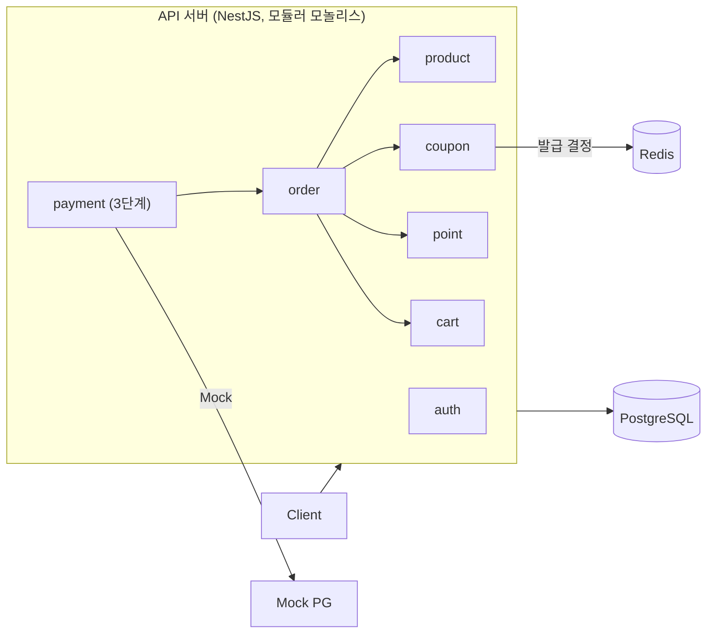

# flash-gate

> 플래시 세일이 열리는 순간 요청이 몰려도 정해진 수량만큼만 통과시키는 백엔드입니다.

## 1. 개요

- 상황: 1만 장 한정 쿠폰에 10만 명이 행사 시작 1분 안에 몰리고, 쿠폰을 받은 회원은 재고가 한정된 행사 상품을 주문합니다 (가정).
- 목표: 초과 발급·초과 판매 0건, 중복 발급·중복 주문 0건, 쿠폰 발급 3,000 RPS에서 p99 300ms 이하입니다.
- 진행: 1단계 로그인·쿠폰 발급, 2단계 상품·장바구니·주문·포인트 사용, 3단계 Mock 결제·포인트 비동기 적립 순서로 진행합니다.
- 지금: 3단계까지 설계 문서를 다 썼고, 아직 구현 전입니다.
- 자세한 내용은 [문제 정의](docs/reference/problem.md)와 [유저 플로우](docs/reference/user-flows.md)에 있습니다.

## 2. 결과

Risk ID는 기능 문서에서 정하고, 아직 측정 전입니다.

| Risk | 기능 | 문제 | 해결 | Before / After | 근거 |
|---|---|---|---|---|---|
| R1 | [쿠폰](docs/features/coupon/) | 동시 요청 시 초과 발급 | | | |
| R2 | [쿠폰](docs/features/coupon/) | 같은 회원의 중복 요청이 409로 끝나지 않음 | | | |
| R3 | [쿠폰](docs/features/coupon/) | Redis 수량과 회원 쿠폰 기록 불일치 | | | |
| R4 | [쿠폰](docs/features/coupon/) | 몰릴 때 응답 지연·서버 에러 | | | |
| R5 | [쿠폰](docs/features/coupon/) | Redis 재시작 후 초과 발급 | | | |
| R6 | [주문](docs/features/order/) | 재고 초과 판매 | | | |
| R7 | [주문](docs/features/order/) | 쿠폰 이중 사용 | | | |
| R8 | [주문](docs/features/order/) | 여러 상품 주문의 데드락 | | | |
| R9 | [주문](docs/features/order/) | 주문 금액 불일치 | | | |
| R10 | [주문](docs/features/order/) | 중복 주문 | | | |
| R11 | [포인트](docs/features/point/) | 포인트 이중 사용 | | | |
| R12 | [포인트](docs/features/point/) | 포인트 이중 적립 | | | |
| R13 | [결제](docs/features/payment/) | 승인 후 주문 실패 시 보상 실패 | | | |
| R14 | [결제](docs/features/payment/) | 승인 결과를 알 수 없음 | | | |

## 3. 기술 스택

- Node.js 24, TypeScript 6, NestJS 12
- PostgreSQL, Redis (버전은 docker compose 작성 시 확정)
- TypeORM, `@nestjs-cls/transactional` (트랜잭션 전파)
- Vitest (테스트), oxlint (린트), Prettier (포맷), dependency-cruiser (모듈 경계 검사, 도입 예정)
- k6 (부하 테스트, 도입 예정)

## 4. 아키텍처

모듈러 모놀리스로 만듭니다. 모듈끼리는 공개 서비스를 함수로 호출하고, 다른 모듈의 테이블은 직접 쓰지 않습니다 ([ADR-0002](docs/adr/0002-modular-monolith-with-one-port.md)).
쿠폰 발급은 Redis가 결정하고 DB는 기록만 합니다 ([ADR-0001](docs/adr/0001-redis-decides-coupon-issue.md)). 아직 DB와 Redis는 연결하지 않았습니다.



## 5. 문서

전체 목록은 [문서 지도](docs/README.md)에 있습니다.

| 문서 | 내용 |
|---|---|
| [문제 정의](docs/reference/problem.md) | 가정 트래픽, 단계, 목표 수치, 범위 밖 |
| [유저 플로우](docs/reference/user-flows.md) | 회원이 겪는 모든 흐름과 번호 |
| [ERD](docs/reference/erd.md) | 전체 테이블, 제약 조건, 인덱스, 반정규화, 삭제 정책 |
| [API 공통 규칙](docs/reference/api.md) | 경로, 인증, 멱등성, 에러 형식 |
| [개발 규칙](docs/reference/conventions.md) | 명령, 작업 순서, 아키텍처, 트랜잭션, DB 규칙 |
| [용어집](docs/reference/glossary.md) | 도메인 용어와 뜻, 피할 말 |
| [구현 순서](docs/reference/roadmap.md) | 코드를 만드는 순서와 끝난 기준 |
| 기능 | [인증](docs/features/auth/) · [쿠폰](docs/features/coupon/) · [상품](docs/features/product/) · [장바구니](docs/features/cart/) · [주문](docs/features/order/) · [포인트](docs/features/point/) · [결제](docs/features/payment/) |
| [ADR](docs/adr/) · [실험](docs/experiments/) | 결정 기록, 부하 테스트 기록과 계획 |

## 6. 실행 방법

```bash
npm ci             # 의존성 설치
npm run start:dev  # 개발 서버 (http://localhost:3000)
npm run lint       # 린트 (타입 정보 기반 규칙 포함)
npm test           # 단위 테스트
npm run test:e2e   # e2e 테스트
```

DB, Redis, 부하 테스트 실행 방법은 도입할 때 추가합니다.
