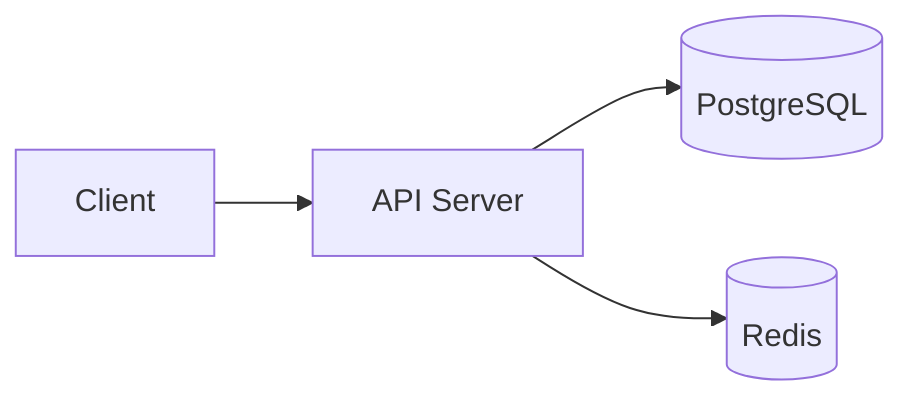

# flash-gate

> 플래시 세일이 열리는 순간 몰리는 요청을, 정해진 수량만큼만 정확히 통과시키는 백엔드

## 1. 개요

- **상황**: 1만 장 한정 쿠폰에 10만 명이 행사 시작 1분 안에 몰린다 (가정)
- **목표**: 초과 발급 0건, 중복 발급 0건, 3,000 RPS에서 p99 300ms 이하
- **진행**: 1단계 한정 수량 쿠폰 발급 → 2단계 주문·재고 → 3단계 결제·적립금
- 자세한 내용: [문제 정의](docs/00-problem.md)
- 참고한 프로젝트: [f-lab-edu/cyber-monday](https://github.com/f-lab-edu/cyber-monday)

## 2. 핵심 결과

Risk ID는 [사용자 시나리오](docs/01-scenarios.md)에서 정합니다. 아직 측정 전입니다.

| Risk | 문제 | 해결 | Before → After | 근거 |
|---|---|---|---|---|
| R1 | 동시 요청 시 초과 발급 | | | |
| R2 | 연타 시 중복 발급 | | | |
| R3 | 저장 실패 시 수량·기록 불일치 | | | |
| R4 | 몰릴 때 응답 지연·서버 에러 | | | |

## 3. 기술 스택

- Node.js 24, TypeScript 6, NestJS 12
- Vitest (테스트), oxlint (린트), Prettier (포맷)
- PostgreSQL, Redis (도입 예정, 버전은 docker compose 작성 시 확정)
- k6 (부하 테스트, 도입 예정)

## 4. 아키텍처

목표 구조입니다. 아직 DB와 Redis는 연결하지 않았습니다.



## 5. 문서 지도

| 순서 | 문서 | 내용 |
|---|---|---|
| 00 | [문제 정의](docs/00-problem.md) | 가정 트래픽, 목표 수치, 범위 밖 |
| 01 | [사용자 시나리오](docs/01-scenarios.md) | 케이스별 흐름과 깨지는 지점(Risk) |
| 02 | [ERD](docs/02-erd.md) | 테이블, 제약 조건, 인덱스 이유 |
| 03 | [Flow](docs/03-flows.md) | 핵심 케이스 시퀀스 다이어그램 |
| 04 | [API](docs/04-api.md) | 엔드포인트, 멱등성, 에러 코드 |
| - | [ADR](docs/adr/) | 기술·설계 결정 기록 |
| - | [실험](docs/experiments/) | 부하 테스트와 개선 기록 |

## 6. 실행 방법

```bash
npm ci             # 의존성 설치
npm run start:dev  # 개발 서버 (http://localhost:3000)
npm run lint       # 린트 (타입 정보 기반 규칙 포함)
npm test           # 단위 테스트
npm run test:e2e   # e2e 테스트
```

DB, Redis, 부하 테스트 실행 방법은 도입할 때 추가합니다.
