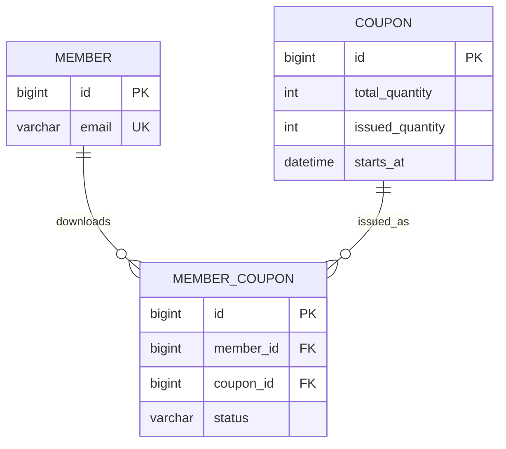

# 02. ERD

> **작성 전입니다.** 아래 내용은 템플릿 예시이며, 확정된 설계가 아닙니다.

## 제약 조건과 인덱스

ERD에서 보이지 않는 결정을 적습니다. 정합성을 DB가 지키는지, 애플리케이션이 지키는지 구분합니다.

| 테이블 | 제약/인덱스 | 이유 | 관련 Risk |
|---|---|---|---|
| member_coupon | UNIQUE(member_id, coupon_id) | <예: 중복 발급을 DB에서 최종 차단> | R2 |
| coupon | <예: CHECK issued ≤ total> | | R1 |

## 상태 값

| 테이블.컬럼 | 값 | 전이 |
|---|---|---|
| member_coupon.status | ISSUED, USED, EXPIRED | ISSUED → USED, ISSUED → EXPIRED |

---

[← 이전: 01. 사용자 시나리오](01-scenarios.md) | [README](../README.md) | [다음: 03. Flow →](03-flows.md)
