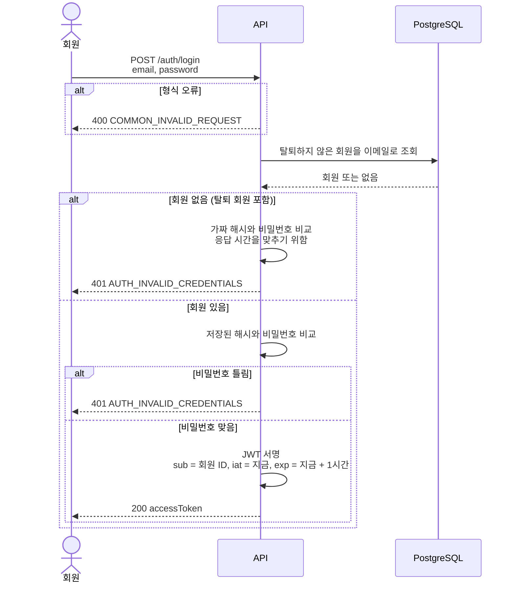
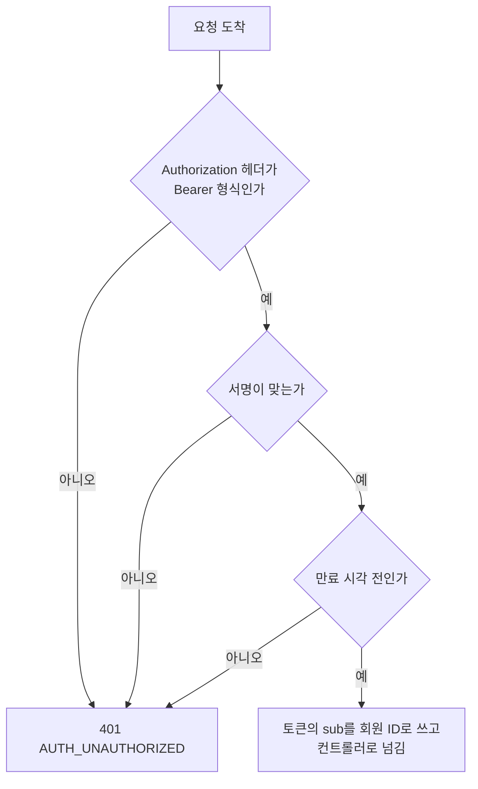

# 인증: Flow

로그인(시나리오 1, 2)과 토큰 검사(시나리오 3)를 그립니다.

## 시나리오 1, 2. 로그인



회원 조회 SQL입니다. 탈퇴한 회원은 조건에서 빠집니다.

```sql
SELECT id, password_hash
FROM member
WHERE email = :email
  AND deleted_at IS NULL;
```

- 이 조회는 `uq_member_email_active` 부분 인덱스를 씁니다 ([ERD](../../reference/erd.md#member-회원)).
- 로그인은 데이터를 바꾸지 않습니다. 트랜잭션이 필요 없습니다.
- JWT 서명 키는 환경 변수(`JWT_SECRET`)에서 읽습니다. 코드와 문서에 값을 적지 않습니다.

## 시나리오 3. 토큰 검사

로그인이 필요한 모든 API 앞에서 Nest Guard가 토큰을 검사합니다.



- Guard는 DB를 읽지 않습니다. 쿠폰 발급처럼 몰리는 요청마다 회원 조회가 붙지 않게 하려는 것입니다.
- 그래서 탈퇴한 회원의 토큰은 만료될 때까지 통과합니다. [허용하는 불일치](README.md#시나리오-3-토큰-없이-잘못된-토큰-만료된-토큰으로-요청)에 적었습니다.

---

[← 이전: 인증](README.md) | [문서 지도](../../README.md) | [다음: API →](api.md)
