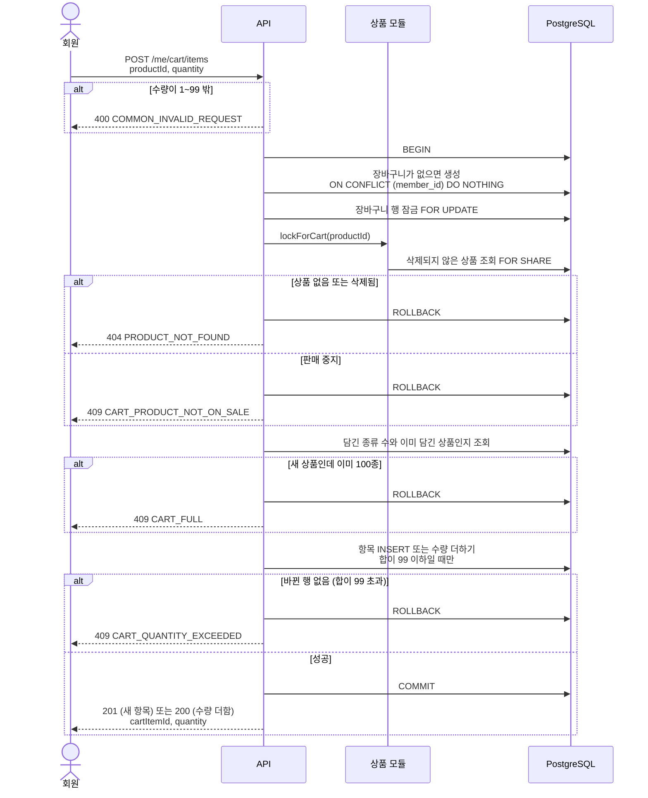
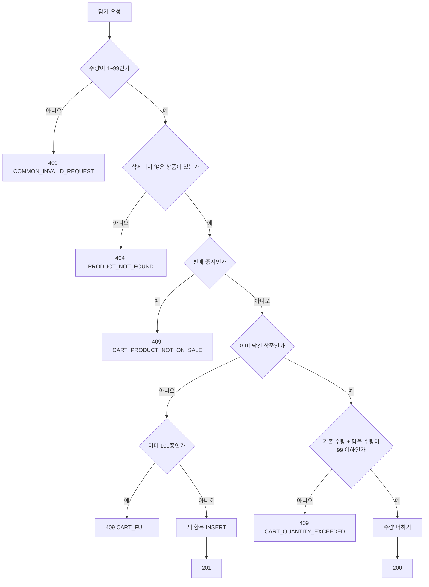
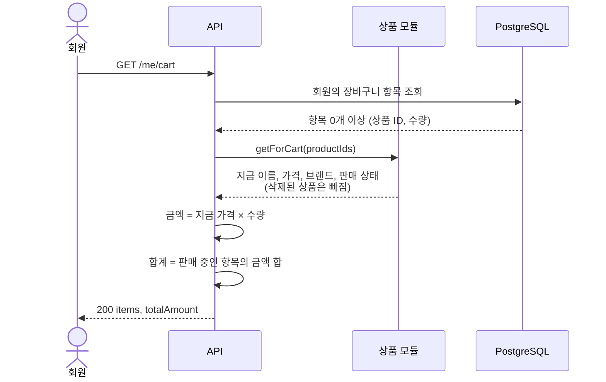
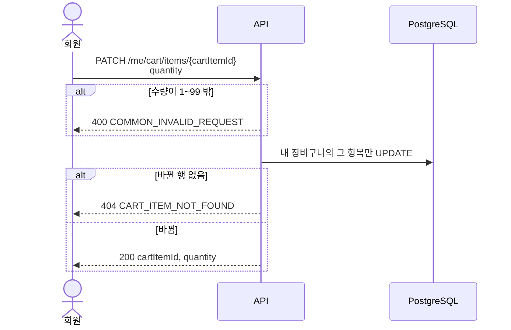
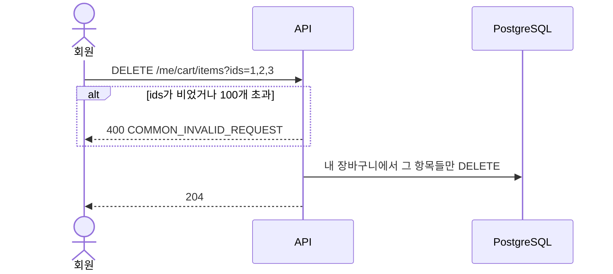

# 장바구니: Flow

담기(시나리오 1)만 트랜잭션이 필요하고, 나머지는 SQL 한 문장으로 끝납니다.
모든 SQL은 회원 ID 조건을 함께 걸어서, 다른 회원의 장바구니를 건드리지 못하게 합니다.

## 시나리오 1. 장바구니에 담기



#### 트랜잭션 안의 SQL

아래 SQL을 순서대로 실행합니다.

```sql
-- 1. 장바구니가 없으면 만든다. 동시에 두 번 와도 하나만 생긴다.
INSERT INTO cart (member_id, created_at, updated_at)
VALUES (:memberId, now(), now())
ON CONFLICT (member_id) DO NOTHING;

-- 2. 장바구니 행을 잠근다. 같은 회원의 담기를 한 줄로 세운다.
SELECT id FROM cart WHERE member_id = :memberId FOR UPDATE;

-- 3. 상품을 확인하고 공유 잠금을 건다. 상품 모듈의 lockForCart(productId)가 실행한다.
SELECT status FROM product
WHERE id = :productId AND deleted_at IS NULL
FOR SHARE;

-- 4. 100종 제한을 확인한다.
SELECT count(*) AS item_count,
       coalesce(bool_or(product_id = :productId), false) AS already_in_cart
FROM cart_item
WHERE cart_id = :cartId;

-- 5. 새 상품이면 넣고, 이미 있으면 수량을 더한다. 합이 99를 넘으면 아무 행도 바꾸지 않는다.
INSERT INTO cart_item (cart_id, product_id, quantity, created_at, updated_at)
VALUES (:cartId, :productId, :quantity, now(), now())
ON CONFLICT (cart_id, product_id) DO UPDATE
  SET quantity = cart_item.quantity + EXCLUDED.quantity,
      updated_at = now()
  WHERE cart_item.quantity + EXCLUDED.quantity <= 99
RETURNING id, quantity;
```

- 응답 코드는 4번에서 "이미 담긴 상품인가"를 본 결과로 정합니다. 새 항목이면 201, 수량을 더했으면 200입니다. 2번의 장바구니 행 잠금 덕분에 4번과 5번 사이에 결과가 바뀌지 않습니다.
- 5번에서 `RETURNING`이 아무 행도 돌려주지 않으면 이미 담긴 상품의 수량 합이 99를 넘은 것입니다. 이때는 99로 줄여 담지 않고, `409 CART_QUANTITY_EXCEEDED`로 응답하고 롤백합니다.
- 2번의 장바구니 행 잠금이 있어야 4번의 "100종 확인"과 5번의 INSERT 사이에 같은 회원의 다른 담기가 끼어들지 못합니다. 잠금은 그 회원의 장바구니 한 행에만 걸려서 다른 회원과 부딪히지 않습니다.
- 3번의 `FOR SHARE`는 상품 삭제와 담기가 동시에 일어나는 경우를 막습니다. 상품 삭제 트랜잭션은 `product` 행을 UPDATE하므로 담기 트랜잭션이 끝날 때까지 기다린 뒤, 이 장바구니 항목까지 지웁니다. 잠금이 없으면 삭제된 상품의 장바구니 항목이 남을 수 있습니다.
- 3번은 직접 쓴 SQL이라 `deleted_at IS NULL`을 직접 적습니다 ([ERD 삭제 정책](../../reference/erd.md#삭제-정책)).
- 수량 합 99 제한은 정책이라 DB CHECK에 두지 않습니다. CHECK는 `quantity > 0`만 겁니다 ([ERD](../../reference/erd.md#cart-cart_item-장바구니)).



품절 상품은 이 흐름에서 거르지 않고, 판매 중지만 거릅니다.

## 시나리오 2. 장바구니 보기



```sql
-- 장바구니 모듈: 자기 테이블만 읽는다
SELECT ci.id AS cart_item_id, ci.product_id, ci.quantity
FROM cart c
JOIN cart_item ci ON ci.cart_id = c.id
WHERE c.member_id = :memberId
ORDER BY ci.created_at DESC, ci.id DESC;
```

- 상품 이름·가격·브랜드·판매 상태는 상품 모듈의 `getForCart(productIds)`로 받습니다. 장바구니 모듈은 `product`, `brand`, `product_stock`을 직접 읽지 않습니다 ([모듈 사이의 규칙](../../reference/conventions.md#모듈-사이의-규칙)).

- 장바구니가 없으면 빈 결과라서 빈 장바구니로 응답합니다.
- 판매 상태는 상품 모듈이 계산해서 줍니다 ([상품 Flow](../product/flows.md#판매-상태-계산)).
- `getForCart`가 삭제된 상품을 빼는 것은 방어용입니다. 상품 삭제가 장바구니 항목을 같이 지우므로 정상이라면 삭제된 상품의 항목은 없습니다. 빠진 항목은 응답에서도 뺍니다.
- 최대 100종이라 페이지 없이 전체를 줍니다.

## 시나리오 3. 수량 바꾸기



```sql
UPDATE cart_item ci
SET quantity = :quantity, updated_at = now()
FROM cart c
WHERE ci.id = :cartItemId
  AND ci.cart_id = c.id
  AND c.member_id = :memberId
RETURNING ci.id, ci.quantity;
```

- 한 문장이라 트랜잭션을 따로 열지 않습니다.
- 회원 ID 조건 때문에 다른 회원의 항목은 바뀌지 않고, 없는 항목과 똑같이 404가 됩니다.
- 새 수량으로 덮어써서, 같은 항목을 동시에 바꾸면 나중에 저장된 값이 남습니다. 회원 한 명의 장바구니라 이를 허용합니다.

## 시나리오 4. 빼기



```sql
DELETE FROM cart_item ci
USING cart c
WHERE ci.cart_id = c.id
  AND c.member_id = :memberId
  AND ci.id = ANY(:ids);
```

- 지워진 행 수와 관계없이 204로 응답합니다. 같은 요청을 다시 보내도 결과가 같습니다.
- 다른 회원의 항목 ID는 회원 ID 조건에 걸려 지워지지 않습니다.
- 행을 실제로 지웁니다. 장바구니 항목에는 `deleted_at`이 없습니다.

---

[이전: 장바구니](README.md) | [문서 지도](../../README.md) | [다음: API](api.md)
