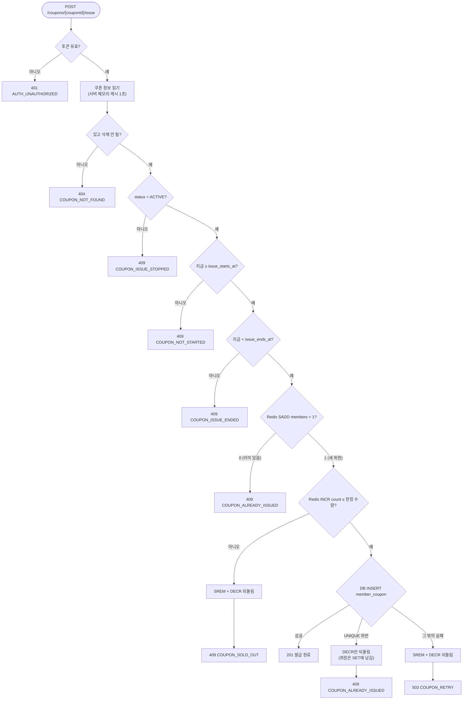
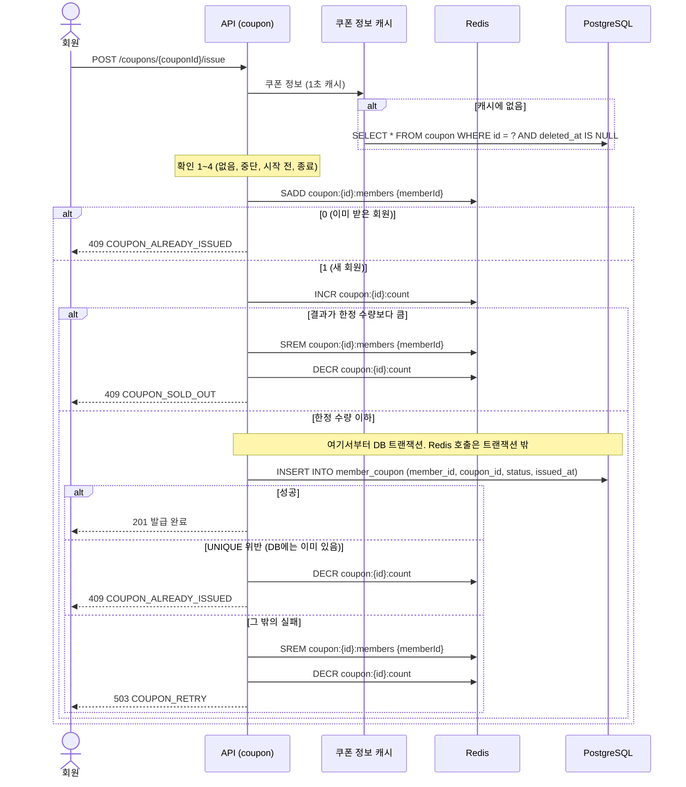
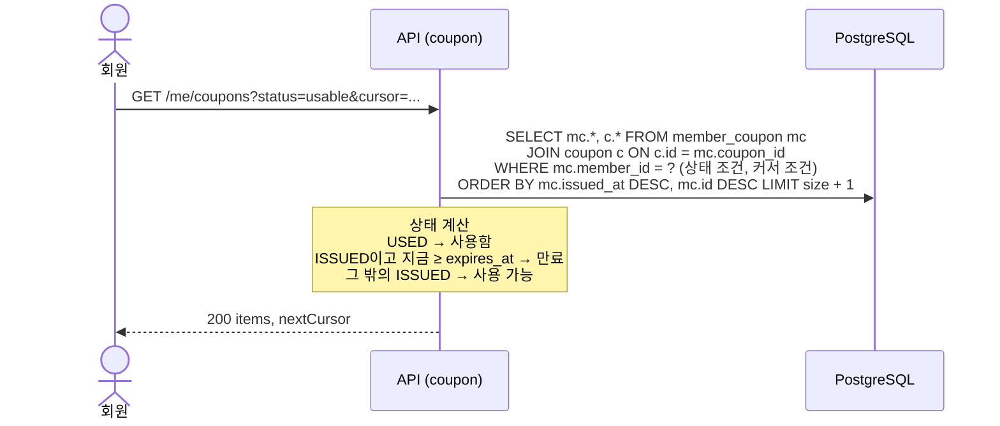
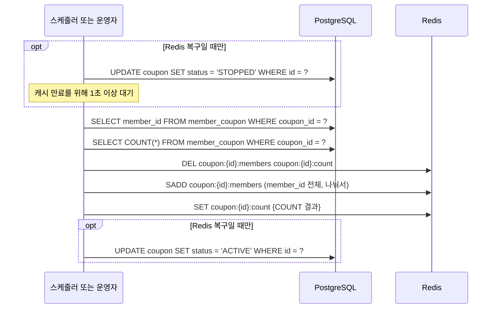

# 쿠폰: Flow

Risk가 있는 시나리오와 시스템 흐름을 그립니다. 시나리오 번호는 [쿠폰 README](README.md)와 같습니다.

## 시나리오 2. 쿠폰 발급받기

관련 Risk: 초과 발급, 같은 회원 중복 요청, 발급 수 불일치, 발급 지연·에러

### 확인 순서

- 1~4번 확인(쿠폰 있음, 발급 중단, 시작, 종료)은 DB를 읽지 않습니다. 쿠폰 정보는 서버 메모리에 1초 캐시합니다 (가정). Redis를 쓰는 목적이 DB 부담을 줄이는 것이라서 요청마다 쿠폰 행을 읽지 않습니다.
- 시각 비교는 서버 시각으로 합니다. 서버가 여러 대면 서버 시각이 조금씩 다를 수 있어서, 경계 시각 근처의 오차는 허용합니다 (가정).

### 시퀀스

- `issued_at`에는 앱이 INCR 결과를 받은 시각을 넣고, 이 값이 선착순의 증거입니다.
- DB 트랜잭션에는 INSERT 한 문장만 넣어서, Redis 왕복 동안 DB 커넥션을 붙잡지 않습니다.

### 소진 응답에서도 DECR하는 이유

`coupon:{id}:count`는 "지금 나간 장수"를 뜻해야 합니다 ([ERD Redis 키](../../reference/erd.md#redis-키)). 소진 응답에서 DECR하지 않으면 이 값이 한정 수량을 넘어 계속 커집니다. 그러면 다른 회원의 저장이 실패해서 1을 되돌려도 그 자리가 다시 열리지 않습니다.

| 경우 | 소진 때 DECR 안 함 | 소진 때 DECR 함 |
|---|---|---|
| 한정 100, 발급 수 100에서 B가 요청 | 101이 되어 소진. 발급 수 101로 남음 | 101이 되어 소진, 다시 100으로 돌아감 |
| 그 뒤 A의 저장이 실패해 DECR | 100. 한정 수량과 같아서 다음 요청도 소진 | 99. 다음 요청 C가 100번째로 받음 |
| 결과 | 영구히 1장 덜 발급 | 덜 발급 없음 |

처리 중인 요청이 겹치는 아주 짧은 순간에는 자리가 났는데도 소진 응답이 나갈 수 있고, 이 경우는 허용합니다. INCR 결과가 한정 수량 이하인 요청만 INSERT까지 가기 때문에 초과 발급은 일어나지 않습니다.

## 실패 시 처리

| 실패 지점 | 처리 | 남는 어긋남 | Risk |
|---|---|---|---|
| SADD 실패 (Redis 연결 오류) | 아무것도 바뀌지 않음. 503 `COUPON_RETRY` | 없음 | 발급 지연·에러 |
| INCR 실패 | SREM으로 되돌림. 503 | 되돌리기도 실패하면 회원이 SET에 남아 "이미 받음"으로 막힘. Redis 복구로 해결 | 발급 수 불일치 |
| INSERT가 UNIQUE 위반 | DECR만 하고 409 `COUPON_ALREADY_ISSUED`. 회원은 SET에 그대로 둡니다 | 없음. Redis가 DB와 다시 맞춰집니다 | 같은 회원 중복 요청, 발급 수 불일치 |
| INSERT가 그 밖의 이유로 실패 (DB 오류, 타임아웃) | SREM + DECR로 되돌리고 503 | 타임아웃인데 실제로는 커밋됐으면, 회원 쿠폰은 있는데 Redis는 없음. 다음 요청이 UNIQUE 위반으로 위 줄처럼 맞춰집니다 | 발급 수 불일치 |
| 되돌리기(SREM, DECR) 자체가 실패 | 503을 응답하고 로그를 남깁니다 | Redis 발급 수가 실제보다 커서 덜 발급. Redis 복구로 해결 | 발급 수 불일치 |
| INCR 뒤, INSERT 전에 서버가 죽음 | 처리할 기회가 없음 | 덜 발급. Redis 복구로 해결 | 발급 수 불일치 |
| SADD 뒤, INCR 전에 서버가 죽음 | 처리할 기회가 없음 | 그 회원이 "이미 받음"으로 막힘. Redis 복구로 해결 | 발급 수 불일치 |
| Redis 재시작 | 없음 (아직) | 발급 수가 0부터 다시 시작해 초과 발급 | Redis 재시작 |

#### UNIQUE 위반일 때 회원을 SET에서 빼지 않는 이유

- 기준은 DB입니다. DB에 회원 쿠폰이 있으면 그 회원은 실제로 쿠폰을 가진 것입니다.
- SADD가 1을 돌려줬다는 것은 Redis가 그 사실을 잃어버렸다는 뜻입니다. 방금 SADD로 다시 넣었으니 Redis는 DB와 맞춰진 상태이고, 여기서 SREM하면 다시 어긋납니다.
- INCR은 실제로 일어나지 않은 발급을 하나 더 센 것이라 DECR로 되돌립니다.
- 이 경우가 생기면 Redis가 DB와 어긋나 있었다는 신호라서, 경고 로그를 남기고 실험에서 건수를 셉니다.

#### 쿠폰 삭제와 캐시

- 쿠폰 정보를 1초 캐시하므로, 발급 시작 직전에 쿠폰을 지우면 캐시에 남은 옛 정보로 발급이 열릴 수 있습니다.
- 그래서 쿠폰 삭제는 발급 시작 10분 전까지만 합니다 (가정). 이 시점은 발급 준비(시작 5분 전)보다 앞서고, 캐시 시간보다 충분히 깁니다.

## 시나리오 3. 회원 쿠폰 목록 보기

| 상태 거르기 | SQL 조건 |
|---|---|
| `usable` | `mc.status = 'ISSUED' AND c.expires_at > now()` |
| `used` | `mc.status = 'USED'` |
| `expired` | `mc.status = 'ISSUED' AND c.expires_at <= now()` |
| 없음 | 조건 없음 |

- 회원 한 명의 회원 쿠폰은 많지 않다고 봅니다 (가정). `UNIQUE(member_id, coupon_id)` 인덱스로 회원의 행을 찾고 정렬합니다. 많아지면 `(member_id, issued_at)` 인덱스를 검토합니다.
- TypeORM은 JOIN한 `coupon`에서 삭제된 행을 자동으로 거르지만, 삭제는 발급 시작 전에만 하므로 걸러질 회원 쿠폰이 없습니다.

## 시나리오 4. (시스템) 발급 준비와 Redis 복구

관련 Risk: 발급 수 불일치, Redis 재시작

- 발급 준비는 발급 시작 5분 전에 돕니다 (가정). 대상은 `status = 'ACTIVE' AND deleted_at IS NULL AND issue_starts_at`이 5분 안에 오는 쿠폰입니다.
- COUNT와 회원 목록은 `member_coupon`만 읽고, 다른 테이블과 JOIN하지 않습니다 ([집계 규칙](../../reference/erd.md#집계-규칙)). 탈퇴한 회원의 회원 쿠폰도 셉니다.
- 1만 명 규모의 SADD는 한 번에 보내지 않고 나눠서 보내며, 한 번에 몇 명씩 보낼지는 구현할 때 정합니다.
- 멈추지 않으면 다시 채우는 사이의 발급이 복구 값에서 빠지므로, 복구 중에는 발급을 멈춥니다.

## 일부러 깨뜨리는 첫 구현 (Before)

발급 방식은 `IssuanceStrategy` 포트 뒤에 둡니다 ([모듈러 모놀리스와 포트 기준](../../adr/0002-modular-monolith-with-one-port.md)). 환경 변수 `ISSUANCE_STRATEGY` 하나로 바꿔 끼우고, 같은 k6 시나리오로 잽니다.

| 구현 | 방식 | 예상 | 역할 |
|---|---|---|---|
| `CountThenInsertIssuance` | `SELECT COUNT(*)`로 남은 수량을 확인하고, 잠금 없이 INSERT | 동시 요청이 같은 COUNT를 읽어 초과 발급 (초과 발급 재현) | Before. 일부러 깨뜨린 구현 |
| `PessimisticLockIssuance` | 트랜잭션 안에서 `SELECT ... FROM coupon WHERE id = ? FOR UPDATE`, COUNT, INSERT 순서로 실행 | 초과 발급은 0. 모든 요청이 쿠폰 행 잠금을 기다려 p99가 느림 (발급 지연·에러 비교 대상) | DB만으로 맞게 만든 기준선 |
| `RedisFirstIssuance` | 이 문서의 [쿠폰 발급받기](#시나리오-2-쿠폰-발급받기) 흐름 (SADD, INCR, INSERT 순서) | 초과 발급 0, 소진 요청이 DB에 가지 않음 | 채택한 구현 ([Redis가 쿠폰 발급을 결정](../../adr/0001-redis-decides-coupon-issue.md)) |

- `findOne`, 값 변경, `save()` 순서로 수량 컬럼을 깎는 고전적인 갱신 손실 구현은 쓰지 않습니다. 발급 수 컬럼(`issued_quantity`)을 두지 않기로 해서 깎을 컬럼이 없고, 같은 "읽고 나서 쓰기" 문제는 `CountThenInsertIssuance`로 재현합니다.
- DB만 쓰는 조건부 UPDATE(`WHERE issued_quantity < total_quantity`)도 같은 이유로 비교 대상에서 뺐습니다. 카운터 컬럼 없이 DB만으로 맞게 하는 방법은 쿠폰 행 잠금입니다.
- 실험용 구현은 Before 수치를 다시 낼 때 쓰므로 지우지 않습니다 ([개발 규칙](../../reference/conventions.md#구현을-바꿔-끼우는-곳)).

---

[이전: 쿠폰](README.md) | [문서 지도](../../README.md) | [다음: API](api.md)
