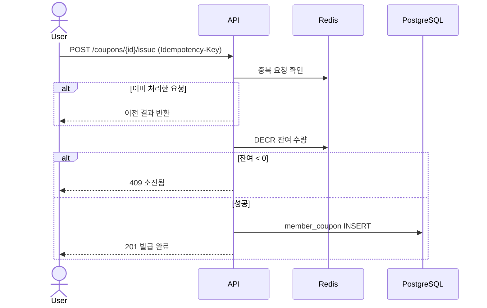

# 쿠폰: Flow

> **작성 전입니다.** 아래 다이어그램은 템플릿 예시이며, 확정된 설계가 아닙니다.
> 첫 구현은 일부러 깨지는 방식(락 없음)으로 만들고, 실험 결과를 본 뒤 이 문서를 확정합니다.

Risk가 있는 시나리오만 그립니다. 단순 조회는 그리지 않습니다.

## 시나리오 1. 한정 수량 쿠폰 다운로드

관련 Risk: `R1`, `R2`, `R3`

**실패 시 처리**

- <예: DB INSERT 실패 시 Redis 수량을 INCR로 되돌린다> `R3`
- <예: 되돌리기도 실패하면 보정 배치가 맞춘다 (미검증)>

---

[← 이전: 쿠폰](README.md) | [문서 지도](../../README.md) | [다음: API →](api.md)
