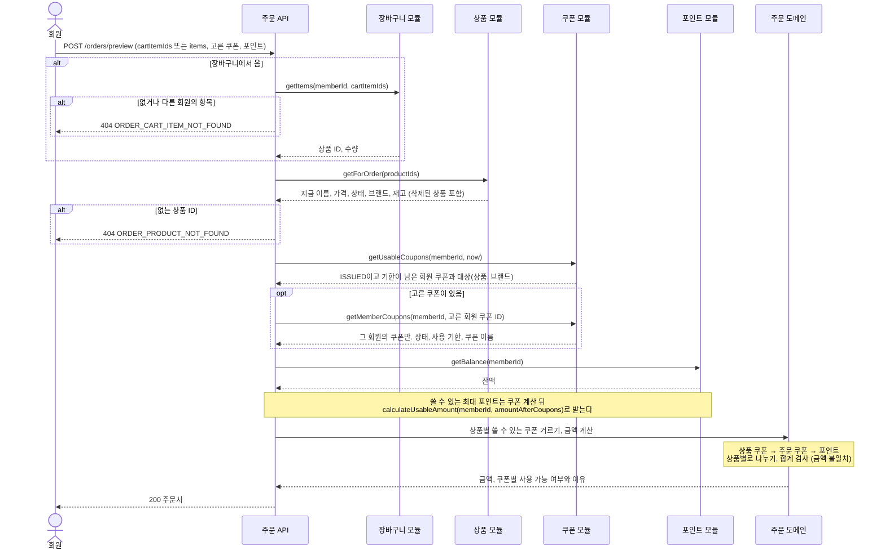
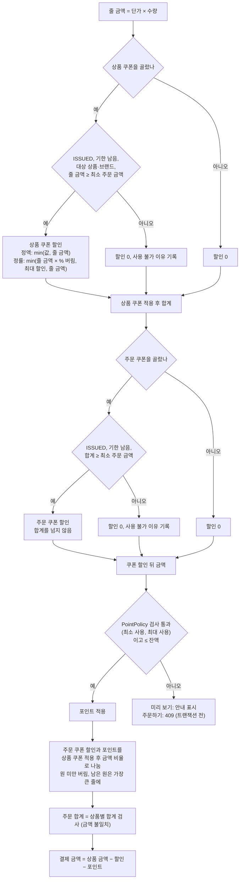
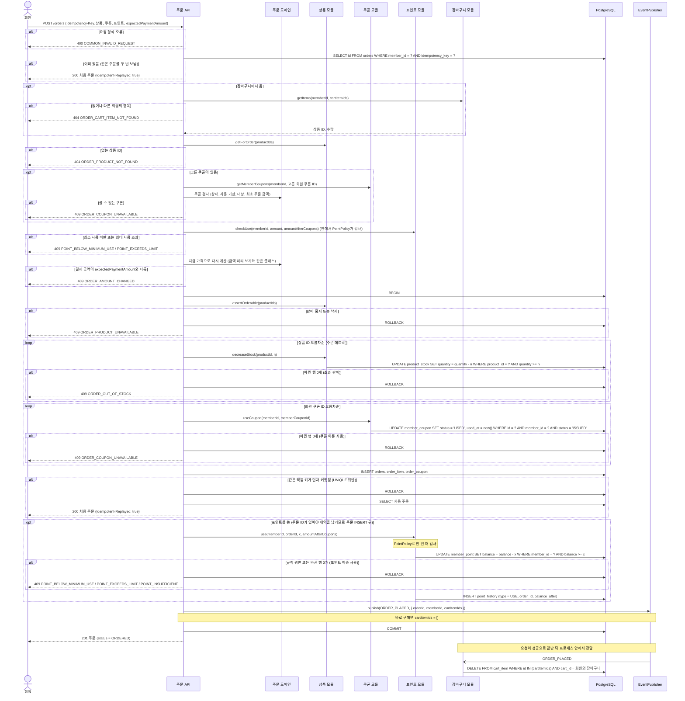
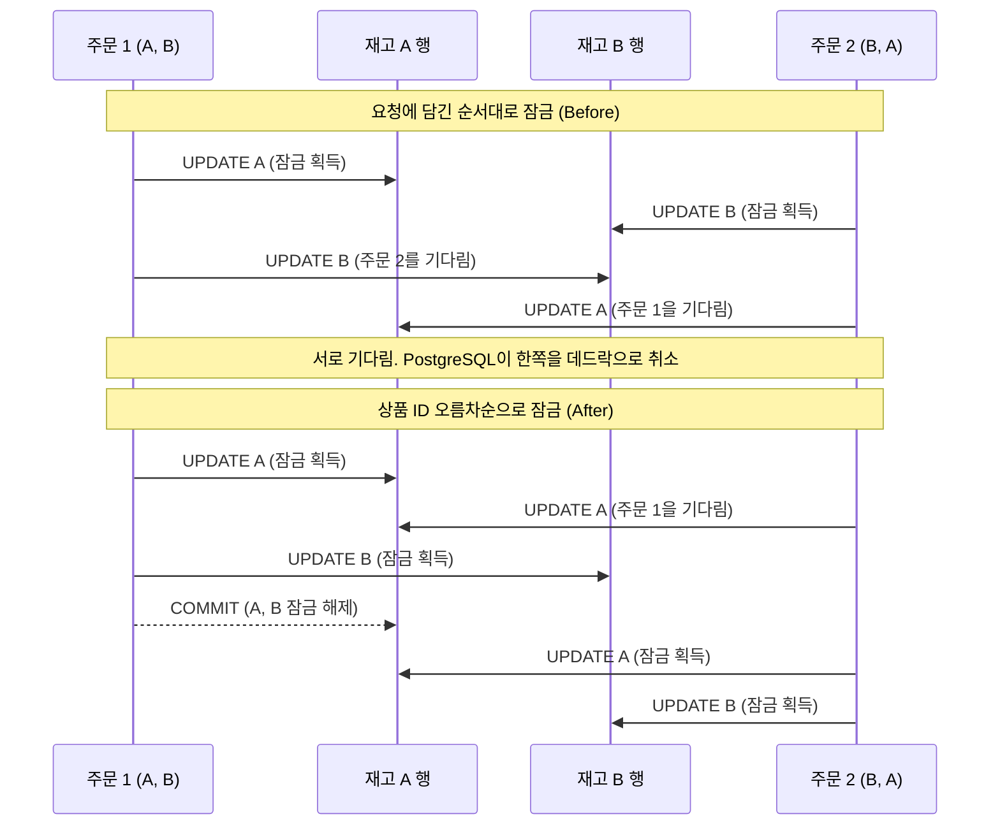
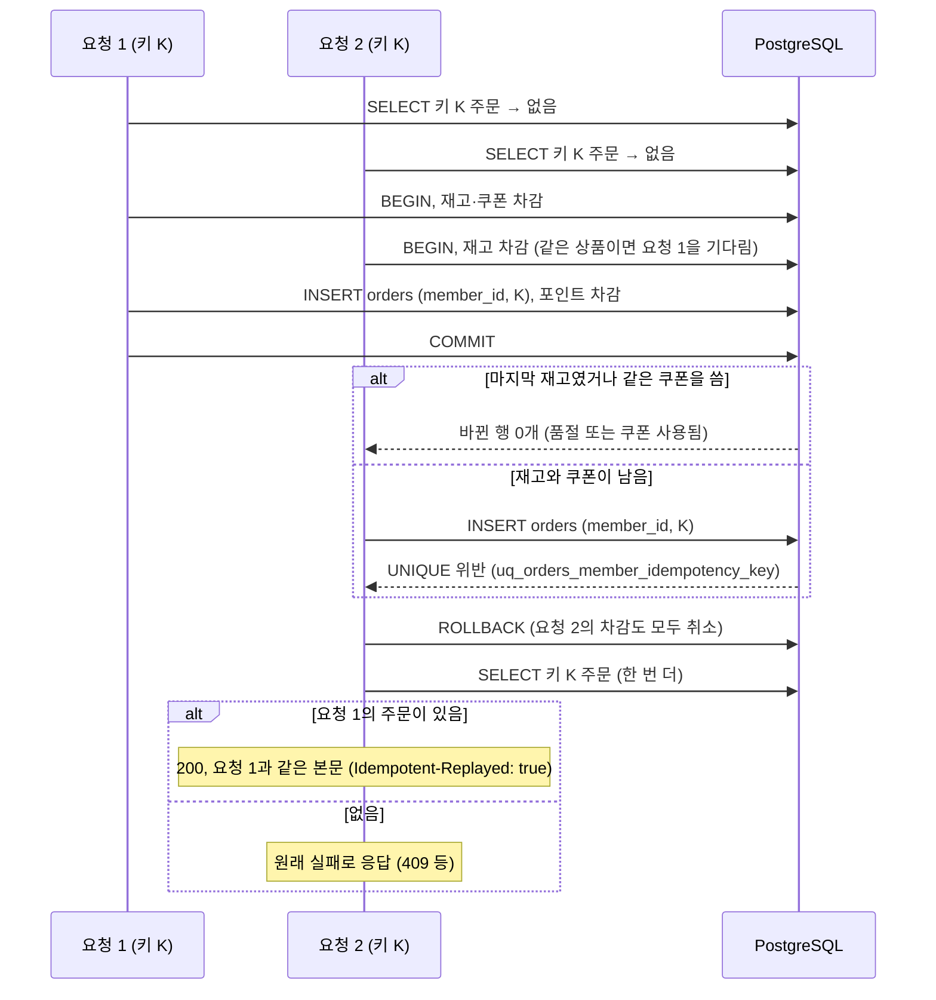
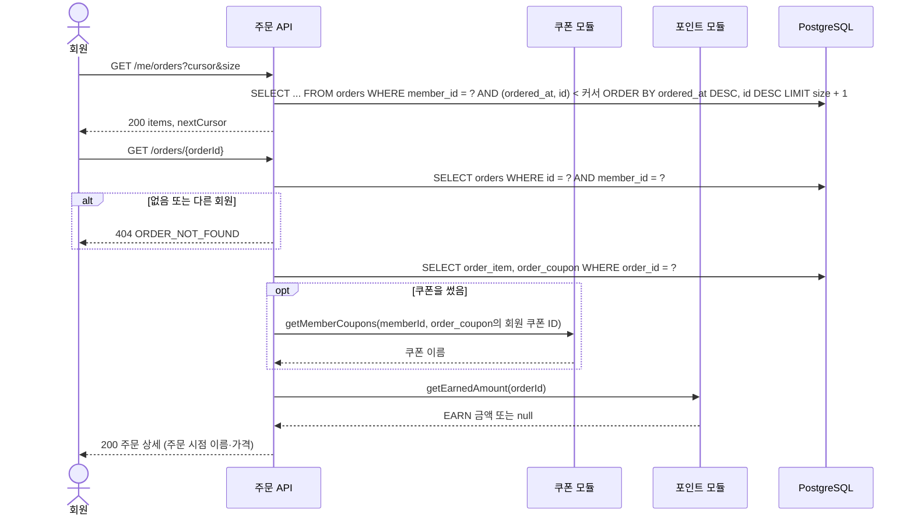
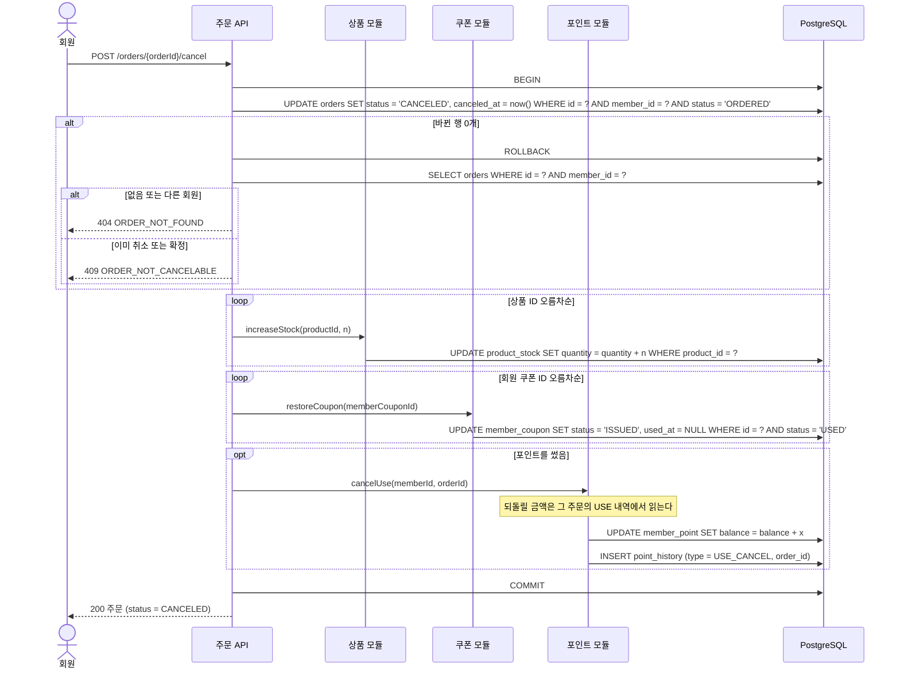
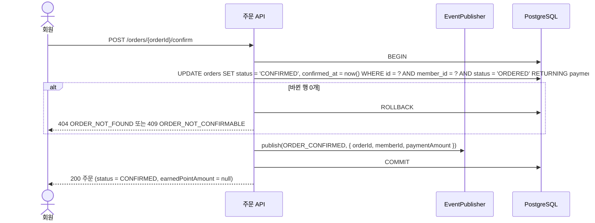
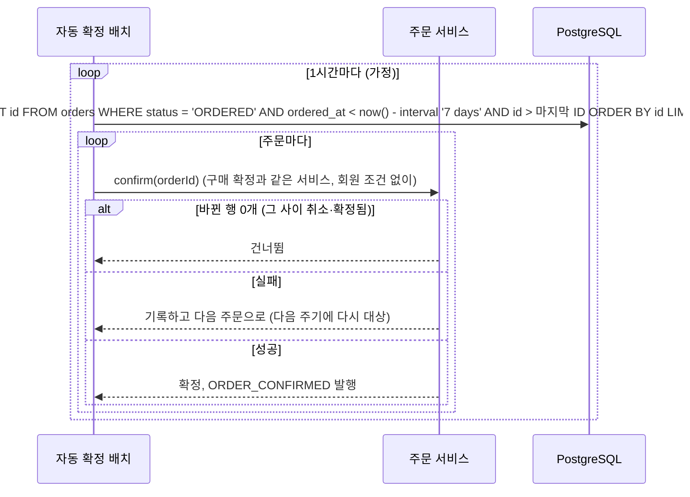

# 주문: Flow

시나리오의 처리 순서, SQL, 트랜잭션 경계를 그립니다. 시나리오의 문장은 [README](README.md)에 있습니다.
다른 모듈(상품, 쿠폰, 포인트, 장바구니)은 HTTP가 아니라 그 모듈이 공개한 서비스를 함수로 부릅니다. 장바구니는 `getItems`로 읽기만 하고, 주문한 항목은 장바구니의 구독자가 이벤트를 받아 지웁니다.
트랜잭션은 `@nestjs-cls/transactional`로 열고, 다른 모듈 서비스도 같은 트랜잭션에 참여합니다 ([개발 규칙](../../reference/conventions.md#트랜잭션)).

## 시나리오 1, 2. 주문서 보기와 금액 미리 보기

`POST /orders/preview` 하나가 두 시나리오를 처리합니다. 고른 쿠폰과 포인트가 없으면 주문서 보기, 있으면 금액 미리 보기입니다. 아무것도 저장하지 않고, 잠그지도 않습니다.

- 재고가 0이면 상품을 "품절"로 표시하지만 주문서는 막지 않고, 주문하기에서 실제로 막습니다.
- 고른 쿠폰을 쓸 수 없으면 미리 보기는 409를 내지 않고, 그 쿠폰을 계산에서 빼고 이유를 함께 응답합니다.
- `NOT_OWNED`, `ALREADY_USED`, `EXPIRED`는 쿠폰 모듈 `getMemberCoupons`의 결과로 정합니다. 결과에 없으면 `NOT_OWNED`, `USED`이면 `ALREADY_USED`, 사용 기한이 지났으면 `EXPIRED`입니다. 나머지 이유(`NOT_TARGET`, `MIN_ORDER_AMOUNT_NOT_MET`, `SCOPE_MISMATCH`)는 주문 도메인 클래스가 정합니다.
- 미리 보기는 [트랜잭션 전 검사 순서](#트랜잭션-전-검사-순서)의 400과 404까지만 응답으로 내고, 쿠폰·포인트·금액 검사는 이유로 담습니다.

### 금액 계산

## 시나리오 3. 주문하기

- 주문됨(`ORDER_PLACED`) 이벤트는 주문마다 트랜잭션 안에서 `publish`합니다. 장바구니에서 오지 않은 주문이면 `cartItemIds`가 빈 배열이고, 구독자는 지울 항목이 없어서 그대로 끝납니다.
- 프로세스 안 구현은 이벤트를 CLS에 모아 두었다가 주문 요청이 성공으로 끝난 뒤 장바구니 구독자에게 전달합니다. 주문이 롤백되면 이벤트도 버려집니다. 구독자는 트랜잭션을 새로 열고, 응답은 구독자를 기다리지 않습니다.
- 이벤트를 잃으면 장바구니에 상품이 남을 뿐이라 프로세스 안 이벤트로 둡니다 ([모듈 사이 반응은 이벤트로](../../adr/0003-module-reactions-through-events.md)).
- 동시에 바뀌는 값(재고, 쿠폰 상태, 잔액)은 트랜잭션 안의 조건부 UPDATE가 지킵니다. 트랜잭션 전 검사를 통과해도 그 사이 바뀐 값은 여기서 걸립니다.
- 포인트 사용 내역은 주문 ID가 있어야 해서 주문을 INSERT한 뒤에 남기고, 잔액 차감과 같은 트랜잭션에서 처리합니다.
- 멱등 키 조회 뒤의 404와 409는 바로 응답하지 않습니다. 트랜잭션 안이면 롤백하고, 멱등 키로 주문을 한 번 더 찾은 다음 응답합니다 ([같은 주문을 두 번 보냄](#시나리오-4-같은-주문을-두-번-보냄)).

#### 트랜잭션 전 검사 순서

주문하기는 아래 순서대로 검사하고, 처음 걸린 검사의 에러로 응답합니다. 금액 미리 보기는 1과 3만 응답으로 내고, 나머지는 응답 본문의 이유로 담습니다.

1. 요청 형식을 검사합니다. 어기면 `400 COMMON_INVALID_REQUEST`입니다 ([요청 검사](api.md#요청-검사)).
2. 멱등 키로 이미 만든 주문을 찾습니다. 있으면 `200` 처음 주문으로 응답합니다.
3. 상품은 `getForOrder`로, 장바구니 항목은 `cart.getItems`로 읽습니다. 없으면 `404 ORDER_PRODUCT_NOT_FOUND` 또는 `404 ORDER_CART_ITEM_NOT_FOUND`입니다.
4. 고른 쿠폰을 `coupon.getMemberCoupons` 결과로 주문 도메인 클래스가 검사합니다. 쓸 수 없으면 `409 ORDER_COUPON_UNAVAILABLE`입니다.
5. 포인트 규칙은 주문 서비스가 포인트 모듈의 공개 서비스 `checkUse()`로 검사하고, 그 안에서 `PointPolicy`가 판단합니다. 어기면 `409 POINT_BELOW_MINIMUM_USE` 또는 `409 POINT_EXCEEDS_LIMIT`입니다.
6. 지금 가격으로 결제 금액을 다시 계산합니다. `expectedPaymentAmount`와 다르면 `409 ORDER_AMOUNT_CHANGED`입니다.
7. 트랜잭션을 엽니다.

- 멱등 키 조회를 404 검사보다 먼저 합니다. 처음 주문이 끝나면 장바구니 항목이 지워져서, 순서가 반대면 같은 키로 다시 보낸 요청이 404를 받습니다.
- 포인트 규칙은 포인트 모듈의 `PointPolicy`에만 있습니다. 주문 쪽은 규칙을 다시 구현하지 않고 `checkUse()`를 부르고, 트랜잭션 안의 `use()`도 같은 클래스로 한 번 더 검사합니다. 주문 도메인 클래스는 다른 모듈을 import하지 않습니다 ([포인트 규칙](../point/README.md#규칙)).
- 잔액 부족은 트랜잭션 안의 조건부 UPDATE에서만 정합니다. 트랜잭션 전에 읽은 잔액은 그 사이 바뀔 수 있습니다.

#### 잠그는 순서

주문하기, 주문 취소, 결제를 붙인 뒤의 결제 실패 복구가 모두 이 순서를 따릅니다. 다른 문서는 이 절을 가리킵니다.

1. 재고를 상품 ID 오름차순으로 잠급니다.
2. 회원 쿠폰을 회원 쿠폰 ID 오름차순으로 잠급니다.
3. 주문을 INSERT합니다. 취소는 이 단계 대신 주문 행을 맨 먼저 UPDATE합니다.
4. 포인트 잔액을 잠급니다.

- 모든 주문과 취소가 이 순서를 지켜서 서로 엇갈려 잠그지 않습니다.
- 그래도 PostgreSQL이 데드락을 감지하면(`40P01`) 트랜잭션이 취소되고 `503 ORDER_RETRY`를 응답합니다. 순서를 지키면 0건이어야 하고, 실험에서 0건인지 셉니다.

### 데드락: 순서를 지키지 않을 때와 지킬 때

## 시나리오 4. 같은 주문을 두 번 보냄

- 트랜잭션 전의 SELECT는 빠른 길이라서, 이미 끝난 요청이면 아무것도 잠그지 않고 바로 응답합니다.
- 동시에 온 두 번째 요청은 재고나 회원 쿠폰 행에서 첫 요청을 기다리다가, 첫 요청이 커밋한 뒤 품절이나 쿠폰 사용됨으로 실패할 수 있습니다. 그래서 첫 조회 뒤 어느 단계에서 실패하든, 롤백한 뒤 에러를 응답하기 전에 `(member_id, idempotency_key)`로 주문을 한 번 더 찾습니다. 있으면 그 주문을 `200`과 `Idempotent-Replayed: true`로 응답합니다.
- 트랜잭션 전 검사의 실패도 같습니다. 첫 요청이 먼저 끝나면 쿠폰은 이미 `USED`이고 장바구니 항목도 지워져서, 두 번째 요청은 409나 404에 걸립니다. 이때도 한 번 더 찾아서 처음 주문을 응답합니다.
- 재고와 쿠폰에 걸리지 않은 두 번째 요청은 UNIQUE 제약이 막습니다. 두 번째 INSERT는 첫 요청이 커밋하거나 롤백할 때까지 기다리고, 첫 요청이 롤백되면 성공합니다.
- 요청 1이 품절 등으로 실패하면 아무것도 저장되지 않아서, 같은 키로 다시 보내면 새로 처리합니다.

## 시나리오 5. 내 주문 목록·상세 보기

- 주문 내역은 `product`와 JOIN하지 않고 `order_item`에 복사한 이름과 가격만 읽어서, 삭제된 상품 때문에 내역이 사라지지 않습니다.
- 쓴 쿠폰의 이름은 쿠폰 모듈의 `getMemberCoupons`로 읽습니다. 발급이 시작된 쿠폰은 삭제되지 않으므로 이름이 사라지지 않습니다.
- `earnedPointAmount`는 포인트 모듈의 `getEarnedAmount(orderId)`로 읽습니다. 확정 전이거나 적립 구독자가 아직 끝나지 않았으면 `null`입니다.

## 시나리오 6. 주문 취소

- 주문 행을 먼저 바꿔서, 동시에 온 두 번째 취소와 구매 확정은 이 행에서 기다렸다가 상태 조건에 걸려 0행이 됩니다.
- 재고와 쿠폰은 주문하기와 같은 순서로 잠급니다.
- `point_history`의 `UNIQUE(order_id, type)` 덕분에 사용 취소 내역은 주문마다 한 번만 생깁니다.

## 시나리오 7. 구매 확정

- 봉투(`eventId`, `type`, `occurredAt`)는 `EventPublisher`가 채웁니다. 응답은 적립을 기다리지 않아서, 적립은 확정 몇 초 뒤에 끝납니다.
- 적립은 포인트 모듈의 구독자가 이벤트를 받아서 합니다. 적립액 계산, 중복 방지, 전달 방식별 차이는 [포인트 Flow](../point/flows.md#시나리오-5-구매-확정으로-포인트-적립)에 있습니다.

## 시나리오 8. (시스템) 자동 구매 확정

- 주문마다 트랜잭션을 따로 열어서, 한 주문의 실패가 다른 주문을 되돌리지 않습니다.
- 배치를 여러 인스턴스에서 동시에 돌려도 상태 조건 덕분에 같은 주문을 두 번 확정하지 않습니다. 적립은 포인트 구독자가 하고, `UNIQUE(order_id, type)`가 한 번만 허용합니다.

## 실패 시 처리

| 실패 | 어디서 | 처리 | 응답 |
|---|---|---|---|
| 없는 상품 ID, 없거나 다른 회원의 장바구니 항목 | 트랜잭션 전 | 아무것도 하지 않음 | 404 `ORDER_PRODUCT_NOT_FOUND` / `ORDER_CART_ITEM_NOT_FOUND` |
| 쿠폰 사용 불가 | 트랜잭션 전 도메인 검사, 또는 트랜잭션 안 쿠폰 조건부 UPDATE | 트랜잭션 안이면 롤백 | 409 `ORDER_COUPON_UNAVAILABLE` |
| 포인트 규칙 위반 | 트랜잭션 전 `PointPolicy` 검사, 트랜잭션 안 `use()`에서 한 번 더 | 트랜잭션 안이면 롤백 | 409 `POINT_BELOW_MINIMUM_USE` / `POINT_EXCEEDS_LIMIT` |
| 지금 가격으로 계산한 금액이 화면 금액과 다름 | 트랜잭션 전 | 아무것도 하지 않음 | 409 `ORDER_AMOUNT_CHANGED` |
| 판매 중지·삭제된 상품 | 트랜잭션 안 첫 단계 | 롤백 | 409 `ORDER_PRODUCT_UNAVAILABLE` |
| 재고 부족 | 재고 조건부 UPDATE | 롤백. 앞서 차감한 다른 상품 재고도 되돌아감 | 409 `ORDER_OUT_OF_STOCK` |
| 포인트 잔액 부족 | 포인트 조건부 UPDATE | 롤백 | 409 `POINT_INSUFFICIENT` |
| 같은 멱등 키가 먼저 커밋됨 | 주문 INSERT | 롤백 후 처음 주문 조회 | 200 처음 주문 |
| 위 실패 중 같은 멱등 키의 주문이 그 사이 커밋됨 | 첫 조회 뒤 어디서나 | 롤백 후 처음 주문 조회 | 200 처음 주문 (`Idempotent-Replayed: true`) |
| 데드락 감지, 잠금 대기 시간 초과 | 어디서나 | 롤백 | 503 `ORDER_RETRY` |
| 주문 합계 ≠ 상품별 합계 | 도메인 클래스 | 저장하지 않음. 버그이므로 로그를 남김 | 500 `COMMON_INTERNAL_ERROR` (금액 불일치, 0건이 목표) |
| 취소·확정할 수 없는 상태 | 주문 조건부 UPDATE | 롤백 | 409 `ORDER_NOT_CANCELABLE` / `ORDER_NOT_CONFIRMABLE` |

모든 쓰기가 한 트랜잭션이라 중간 실패가 남지 않습니다. Redis를 쓰지 않으므로 [쿠폰 발급](../coupon/flows.md)과 달리 보상 작업이 없습니다.

## 일부러 깨뜨리는 첫 구현 (Before)

Risk마다 먼저 깨지는 구현으로 문제를 재현하고, 위 흐름으로 고친 뒤 같은 시나리오로 다시 잽니다. 실험 기록은 [실험](../../experiments/)에 남깁니다.

| Risk | 깨지는 구현 (Before) | 고친 구현 (After) | 재는 것 |
|---|---|---|---|
| 초과 판매 | 재고를 `findOne`으로 읽고 `quantity -= n` 후 `save()`. 두 주문이 같은 값을 읽고 덮어써서 갱신 손실 | 조건부 UPDATE `WHERE quantity >= n` | 처음 재고 1,000개에 1,000 RPS로 30초. 판매 수량 합 − 처음 재고 (초과 판매 수) |
| 쿠폰 이중 사용 | 회원 쿠폰을 읽어 `ISSUED`인지 확인한 뒤 `save()`로 `USED` 저장. 두 주문이 모두 `ISSUED`를 읽음 | 조건부 UPDATE `WHERE status = 'ISSUED'` | 같은 회원·같은 쿠폰으로 주문 10개를 동시에. 쓰인 횟수 |
| 주문 데드락 | 요청에 담긴 순서대로 `SELECT ... FOR UPDATE`로 재고를 잠금 | 상품 ID 오름차순으로 조건부 UPDATE | 상품 A·B를 반대 순서로 담은 주문을 섞어 부하. 데드락 수, 5xx 수 |
| 금액 불일치 | 상품별로 나눌 때 각자 반올림하고 남은 원을 처리하지 않음 | 버림 후 남은 원을 가장 큰 줄에 더하고 합계를 검사 | 무작위 금액 조합 10만 건 속성 테스트. 합계가 다른 주문 수 |
| 중복 주문 | 멱등 키 없이 주문 | `UNIQUE(member_id, idempotency_key)` | 같은 요청을 동시에 2~5번. 생긴 주문 수 |

이 실험들은 아직 하지 않았고, 수치는 측정한 뒤에 씁니다.

---

[이전: 주문](README.md) | [문서 지도](../../README.md) | [다음: API](api.md)
