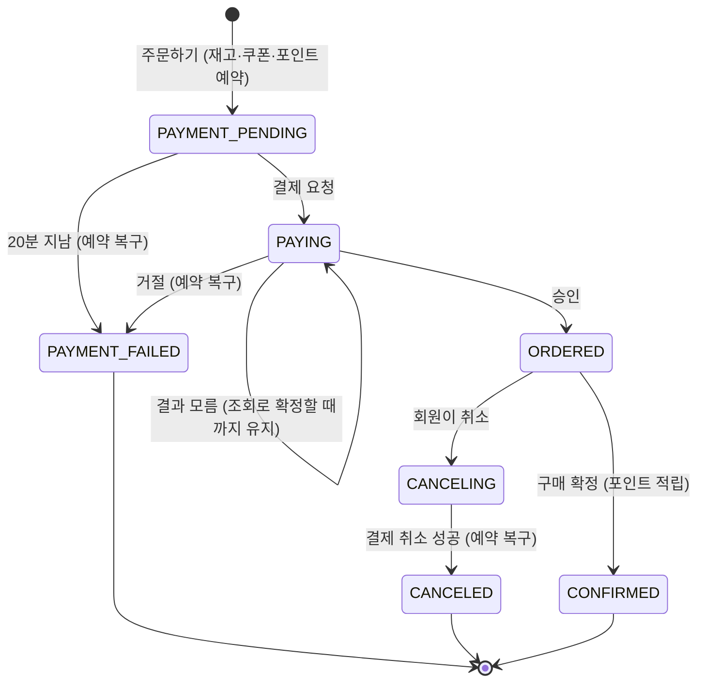

# 결제 (payment)

> 3단계 초안이라 1·2단계를 구현하고 측정한 뒤 확정합니다. 이 문서의 테이블과 상태 값은 아직 [ERD](../../reference/erd.md)에 넣지 않은 제안입니다.

주문한 금액을 Mock 결제사(Mock PG)로 승인받습니다. 승인 결과를 알 수 없거나 중간에 실패해도, 돈과 주문이 어긋난 채로 남지 않게 합니다.

| 항목 | 내용 |
|---|---|
| 단계 | 3단계 ([문제 정의](../../reference/problem.md#단계)) |
| 코드 | `src/payment/` (아직 없음) |
| 상태 | 설계 초안 |
| 관련 테이블 | `orders` ([ERD](../../reference/erd.md#orders-주문)), `payment` (아래 [ERD 제안](#erd-제안-초안)) |
| 관련 흐름 | [유저 플로우](../../reference/user-flows.md#결제-문서-3단계-초안) 결제 1~6 |

## 이 폴더의 문서

| 문서 | 내용 |
|---|---|
| README.md (이 문서) | 설계 방향, 상태, 시나리오, Risk, ERD 제안 |
| [flows.md](flows.md) | 시나리오별 시퀀스 다이어그램, 보상과 타임아웃 처리 |
| [api.md](api.md) | 결제 엔드포인트, Mock PG 동작 제어, 에러 코드 |

## 설계 방향: 먼저 잡아 두고, 나중에 결제한다

주문을 만들 때 재고·쿠폰·포인트를 먼저 차감하고(예약), 그다음 결제합니다.
반대로 결제를 먼저 승인받고 재고를 차감하는 방법도 있습니다.

| | 먼저 예약, 나중에 결제 (flash-gate) | 먼저 결제, 나중에 차감 |
|---|---|---|
| 품절일 때 | 결제 화면에 가기 전에 품절을 알려서 돈이 오가지 않습니다 | 돈을 받은 뒤 품절을 알게 되어 승인 취소(결제 취소)를 해야 합니다 |
| 결제하지 않고 떠나면 | 재고를 붙잡고 있다가 20분 뒤 풀어 줍니다 | 아무것도 붙잡지 않습니다 |
| 보상이 필요한 경우 | 승인 뒤 DB 처리가 실패할 때만 | 승인 뒤 재고 부족, 처리 실패 때 모두 |

- 플래시 세일은 재고가 몇 초 만에 바닥나서 대부분의 실패가 품절입니다. 그래서 품절을 결제 전에 걸러야 보상(승인 취소)이 드뭅니다.
- 대가는 "결제하지 않은 주문이 20분 동안 재고를 붙잡는 것"입니다. 행사 상품이 결제하지 않는 주문에 묶여 있다가 늦게 풀릴 수 있습니다.

## 주문 상태 (3단계 제안)

2단계의 `ORDERED`, `CANCELED`, `CONFIRMED`에 결제 상태를 더합니다.

| 상태 | 뜻 | 재고·쿠폰·포인트 |
|---|---|---|
| `PAYMENT_PENDING` | 주문은 만들어졌고 결제 전 | 예약됨 (차감 상태) |
| `PAYING` | 결제사에 승인을 요청했고 결과를 기다림 | 예약됨 |
| `ORDERED` | 결제 승인 완료. 2단계의 `ORDERED`와 같은 뜻 | 차감 확정 |
| `PAYMENT_FAILED` | 거절되거나 20분 안에 결제하지 않음 | 복구됨 |
| `CANCELING` | 회원이 취소했고 결제 취소를 기다림 | 아직 차감 상태 |
| `CANCELED` | 결제 취소와 복구 완료 | 복구됨 |
| `CONFIRMED` | 구매 확정. 취소할 수 없음 | 차감 확정 |

- 모든 전이는 주문 모듈의 공개 서비스가 조건부 UPDATE 한 문장으로 해서, 두 요청이 겹쳐도 한쪽만 성공합니다. 예를 들어 `startPayment`는 `UPDATE orders SET status = 'PAYING' WHERE id = ? AND status = 'PAYMENT_PENDING'`를 실행합니다. 결제 모듈은 `orders`를 직접 바꾸지 않습니다 ([아래 표](#order-모듈에-필요한-공개-서비스-3단계-제안)).
- 20분 시간 초과 배치는 `PAYMENT_PENDING`만 건드리고, 이미 결제 요청을 보낸 `PAYING` 주문은 풀지 않습니다. 결제사가 승인했는데 재고를 풀어 버리는 경우를 막으려는 것입니다.
- `CANCELING`은 결제 취소 중에 구매 확정이 끼어들지 못하게 하려고 둡니다. 결제 취소가 성공한 뒤 DB 처리가 실패해도, 이 상태가 "아직 끝나지 않은 취소"라는 표시로 남습니다.
- 자동 구매 확정은 주문 7일 뒤에 하고, 3단계부터는 그 기준 시각이 결제 승인 시각(`payment.approved_at`)입니다.

## Risk

Risk ID는 프로젝트 전체에서 이어서 매기고, 전체 결과는 [README 결과 표](../../../README.md#2-핵심-결과)에 모읍니다.

| ID | 깨지는 지점 | 시나리오 | 상태 | 근거 |
|---|---|---|---|---|
| R13 | 결제 승인 뒤 주문 처리가 실패했는데 승인 취소(보상)까지 실패해서, 돈은 나갔는데 주문은 없는 상태로 남는 문제 | 5, 6 | 미해결 | |
| R14 | 타임아웃으로 승인 요청의 응답을 받지 못해 승인됐는지 모르는 상태. 섣불리 실패로 처리하면 돈만 나갑니다 | 4 | 미해결 | |

상태는 `미해결`에서 `재현함`, `해결` 순서로 바뀝니다. 재현함은 Before 수치가, 해결은 After 수치가 있는 상태이고, 미루는 Risk는 `보류`로 둡니다.

---

## 시나리오 1. 주문 후 결제 승인

사전 조건: 주문이 `PAYMENT_PENDING`이고, 주문한 지 20분이 지나지 않았습니다.

1. 회원이 결제 수단(Mock 카드)을 골라 결제합니다.
2. 주문이 `PAYING`이 되고, 결제사에 승인을 요청합니다.
3. 결제사가 승인하면 주문이 `ORDERED`가 되고 "결제가 완료되었습니다"가 보입니다.
   - 결제사가 승인한 금액이 주문의 결제 금액과 다르면 승인을 취소하고 결제 실패로 처리합니다.
   - 같은 결제 요청이 두 번 와도 결제사에는 한 번만 승인을 요청하고, 두 번째 요청에는 "결제를 처리하고 있습니다"가 보입니다.

---

## 시나리오 2. 결제 거절

사전 조건: 주문이 `PAYING`입니다.

1. 결제사가 한도 초과 같은 이유로 승인을 거절합니다.
2. 주문이 `PAYMENT_FAILED`가 되고, 같은 트랜잭션에서 재고·쿠폰·포인트가 복구됩니다.
3. 회원은 "결제가 거절되었습니다"와 거절 이유를 봅니다.
4. 실패한 주문은 다시 결제할 수 없어서, 다시 사려면 주문서부터 다시 시작합니다.

---

## 시나리오 3. 주문 후 20분 안에 결제하지 않음

사전 조건: 주문이 `PAYMENT_PENDING`이고, 주문한 지 20분이 지났습니다.

1. 시간 초과 배치가 1분마다 돕니다 (가정).
2. 20분이 지난 `PAYMENT_PENDING` 주문을 하나씩 `PAYMENT_FAILED`로 바꾸고, 같은 트랜잭션에서 재고·쿠폰·포인트를 복구합니다.
3. 회원이 나중에 그 주문을 결제하려 하면 "결제 시간이 지났습니다"가 보입니다.
   - 회원이 결제를 누른 순간과 배치가 겹치면 조건부 UPDATE에서 먼저 바꾼 쪽만 성공합니다. 결제가 먼저면 배치는 그 주문을 건너뛰고, 배치가 먼저면 결제 요청이 거절됩니다.

#### 허용하는 지연·불일치

- 배치 주기 때문에 20분이 지난 주문의 재고는 최대 1분 늦게 풀립니다.
- 결제사에 승인 요청을 보낸 주문(`PAYING`)은 20분이 지나도 풀지 않습니다.

---

## 시나리오 4. 승인 요청의 응답을 받지 못함

관련 Risk: `R14`

사전 조건: 주문이 `PAYING`입니다.

1. 결제사가 정해진 시간(5초, 가정) 안에 응답하지 않습니다.
2. 주문은 `PAYING`으로 남고, 성공으로도 실패로도 처리하지 않습니다.
3. 회원은 "결제 결과를 확인하고 있습니다"를 보고, 주문 상세에서 결과를 다시 확인합니다.
4. 결과 확인 배치가 `REQUESTED`로 1분 넘게 남은 결제를 찾아, 우리가 보낸 결제 멱등 키로 결제사에 결과를 조회합니다.
   - 승인됐으면 `ORDERED`로 바꿉니다.
   - 거절됐거나 결제사에 기록이 없으면 `PAYMENT_FAILED`로 바꾸고 예약을 복구합니다.
   - 결제사도 응답하지 않으면 `PAYING`을 유지하고, 다음 주기에 다시 조회합니다.
5. 30분이 지나도 확정되지 않으면 운영자 확인 목록에 올립니다 (가정).

#### 허용하는 지연·불일치

- 결과를 모르는 동안 회원은 최대 수 분 동안 "확인 중"을 볼 수 있습니다.
- 돈이 나갔는데 주문이 실패로 끝나는 경우는 0건이어야 합니다.

---

## 시나리오 5. 승인은 됐는데 주문 처리가 실패

관련 Risk: `R13`

사전 조건: 결제사가 승인했습니다.

1. DB 연결 끊김이나 서버 재시작으로 주문을 `ORDERED`로 바꾸는 DB 처리가 실패합니다.
2. 회원은 "결제 결과를 확인하고 있습니다"를 보고, 주문은 `PAYING`으로 남습니다.
3. 결과 확인 배치(시나리오 4)가 결제사에 조회해서 "승인됨"을 확인하고 `ORDERED`로 바꿉니다. 승인 결과는 결제사에 남아 있으므로 다시 시도하면 됩니다.
4. 승인 금액이 주문의 결제 금액과 다를 때처럼 주문을 완료할 수 없는 경우에만 승인을 취소합니다(보상).
   - 승인 취소가 실패하면 "다시 시도할 목록"(outbox)에 올리고 워커가 재시도합니다.
   - 재시도를 다 써도 실패하면 운영자 확인 목록에 올립니다. `R13`

#### 허용하는 지연·불일치

- 승인과 주문 상태가 `ORDERED`가 되는 순간 사이에 최대 수 분이 걸릴 수 있습니다.
- 돈이 나갔는데 주문이 완료도 실패도 아닌 상태로 남은 건수는 보상 후 0이어야 합니다 ([목표 수치](../../reference/problem.md#3단계-결제와-포인트-초안)).

---

## 시나리오 6. 결제된 주문 취소

사전 조건: 주문이 `ORDERED`이고, 구매 확정 전입니다.

1. 회원이 주문을 취소합니다.
2. 주문이 `CANCELING`이 되고, 이 순간부터 구매 확정이 끼어들 수 없습니다.
3. 결제사에 승인 취소를 요청합니다.
4. 취소가 성공하면 한 트랜잭션에서 주문을 `CANCELED`로 바꾸고 재고·쿠폰·포인트를 복구합니다. 그러면 "주문이 취소되었습니다"가 보입니다.
   - 결제사가 취소를 거절하거나 응답하지 않으면 주문은 `CANCELING`으로 남고, 회원은 "취소를 처리하고 있습니다"를 봅니다. 워커가 다시 시도합니다.
   - 결제 취소는 성공했는데 DB 처리가 실패하면 워커가 DB 처리만 다시 합니다. Mock PG는 같은 결제사 거래 ID로 취소 요청을 다시 받아도 한 번만 처리합니다.
   - 이미 `CONFIRMED`, `CANCELED`, `CANCELING`인 주문은 취소할 수 없습니다.

---

## order 모듈에 필요한 공개 서비스 (3단계 제안)

결제 모듈은 `orders`를 직접 바꾸지 않습니다. 주문 상태 전이와 재고·쿠폰·포인트 복구는 주문 모듈이 공개한 서비스로만 합니다 ([ADR-0002](../../adr/0002-modular-monolith-with-one-port.md)). 모든 메서드는 호출한 쪽의 트랜잭션에 참여합니다.
모듈 의존은 결제에서 주문으로 가는 한 방향이고, 주문 모듈은 결제 모듈을 부르지 않습니다. 그래서 3단계부터 결제된 주문의 취소(`POST /orders/{orderId}/cancel`)는 결제 모듈의 유스케이스가 처리합니다.

| 메서드 | 전이 | 하는 일 | 실패 |
|---|---|---|---|
| `startPayment(orderId, memberId)` | `PAYMENT_PENDING → PAYING` | 주문한 지 20분 안인지 같은 UPDATE에서 확인. 결제할 금액을 돌려줌 | 바뀐 행 0개면 결제할 수 없음 |
| `completePayment(orderId)` | `PAYING → ORDERED` | 결제 완료 | 바뀐 행 0개면 이미 처리됨 (다시 시도해도 문제없음) |
| `failPayment(orderId)` | `PAYING → PAYMENT_FAILED` | `payment_failed_at` 기록. `product.increaseStock`, `coupon.restoreCoupon`, `point.cancelUse`로 복구 | 바뀐 행 0개면 이미 처리됨 |
| `expirePayment(orderId)` | `PAYMENT_PENDING → PAYMENT_FAILED` | 시간 초과 배치(주문 모듈)가 부름. 복구는 `failPayment`와 같음 | 바뀐 행 0개면 그사이 결제가 시작된 것이라 건너뜀 |
| `beginCancel(orderId, memberId)` | `ORDERED → CANCELING` | 결제 취소 전에 커밋. 구매 확정이 끼어들지 못함 | 바뀐 행 0개면 취소할 수 없음 (409) |
| `completeCancel(orderId)` | `CANCELING → CANCELED` | `canceled_at` 기록. 2단계 취소와 같은 순서로 복구 | 바뀐 행 0개면 이미 처리됨 |

- 복구는 2단계 주문 취소와 같이 재고, 회원 쿠폰, 포인트 순서로 합니다. 재고는 상품 ID 오름차순, 회원 쿠폰은 ID 오름차순입니다 ([주문 Flow](../order/flows.md)).
- "이미 처리됨"을 에러로 보지 않는 메서드는 결과 확인 배치와 워커가 여러 번 불러도 문제가 없게 하려는 것입니다.

---

## ERD 제안 (초안)

3단계를 확정할 때 [ERD](../../reference/erd.md)에 옮깁니다.

#### orders 변경

| 변경 | 내용 |
|---|---|
| `ck_orders_status` | `PAYMENT_PENDING`, `PAYING`, `ORDERED`, `PAYMENT_FAILED`, `CANCELING`, `CANCELED`, `CONFIRMED` |
| 컬럼 추가 `payment_failed_at` | timestamptz NULL. `ck_orders_payment_failed`: `(status = 'PAYMENT_FAILED') = (payment_failed_at IS NOT NULL)` |
| 인덱스 추가 `ix_orders_payment_pending` | `(ordered_at) WHERE status = 'PAYMENT_PENDING'`. 시간 초과 배치가 찾을 때 씀 |
| 인덱스 추가 `ix_orders_paying` | `(updated_at) WHERE status IN ('PAYING', 'CANCELING')`. 30분 넘게 끝나지 않은 주문을 찾아 운영자 확인 목록에 올릴 때 씀 |

#### payment (새 테이블)

| 컬럼 | 타입 | 제약 |
|---|---|---|
| id | bigint | PK |
| order_id | bigint | NOT NULL, orders를 가리키는 FK. `uq_payment_order_id` (주문당 결제 1건) |
| amount | integer | NOT NULL. `ck_payment_amount`: > 0. 요청 시점의 `orders.payment_amount` |
| status | varchar(20) | NOT NULL. `REQUESTED`, `APPROVED`, `DECLINED`, `CANCEL_REQUESTED`, `CANCELED` |
| pg_idempotency_key | varchar(64) | NOT NULL, `uq_payment_pg_idempotency_key`. 결제사에 보내는 멱등 키. 결과 조회에도 씀 |
| pg_transaction_id | varchar(100) | NULL, `uq_payment_pg_transaction_id`. 승인되면 결제사가 준 거래 ID |
| approved_amount | integer | NULL. 결제사가 승인한 금액 |
| fail_reason | varchar(200) | NULL. 거절 이유 |
| requested_at | timestamptz | NOT NULL |
| approved_at | timestamptz | NULL. `ck_payment_approved`: `(status IN ('APPROVED', 'CANCEL_REQUESTED', 'CANCELED')) = (approved_at IS NOT NULL)` |
| canceled_at | timestamptz | NULL. `ck_payment_canceled`: `(status = 'CANCELED') = (canceled_at IS NOT NULL)` |
| created_at, updated_at | timestamptz | NOT NULL |

- `ix_payment_requested`: `(requested_at) WHERE status = 'REQUESTED'`. 결과 확인 배치(시나리오 4, 5)가 이 인덱스로 찾습니다.
- Mock 결제라도 개인정보처럼 보이는 값을 남기지 않으려고, 결제 수단 정보(카드 번호 등)는 저장하지 않습니다.
- 결제를 거절당한 주문은 다시 결제하지 않으므로 주문당 결제는 1건입니다. 다시 사려면 새 주문을 만듭니다.
- 다시 시도할 일(승인 취소 재시도)은 [포인트 Flow의 outbox 제안](../point/flows.md#3단계-outbox와-워커로-비동기-적립)과 같은 `outbox_event` 테이블에 `PAYMENT_CANCEL_REQUESTED`로 넣습니다.

---

## 관련 결정과 실험

| 종류 | 문서 | 관련 Risk |
|---|---|---|
| ADR | 아직 없음. 후보: "먼저 예약, 나중에 결제" (3단계 확정 때 작성) | R13 |
| 실험 | 아직 없음. 후보: Mock PG 타임아웃 비율을 올려 결과 확인 배치가 모든 `PAYING`을 정리하는지 (`R14`), 승인 뒤 DB를 끊어 보상이 끝까지 되는지 (`R13`) | R13, R14 |

---

[문서 지도](../../README.md) | [다음: Flow](flows.md)
