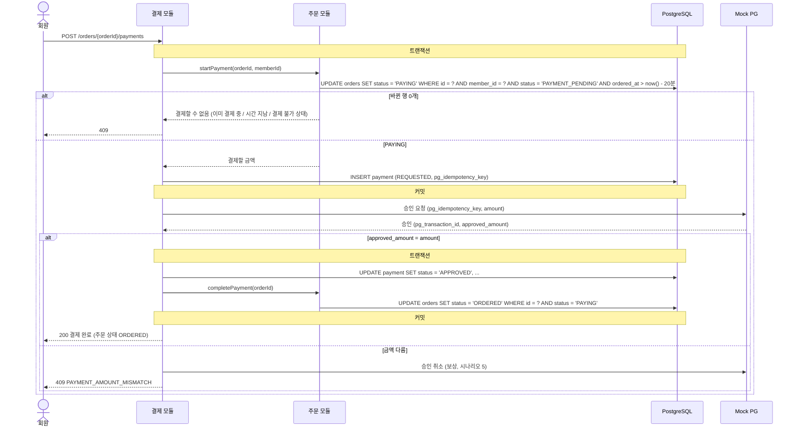
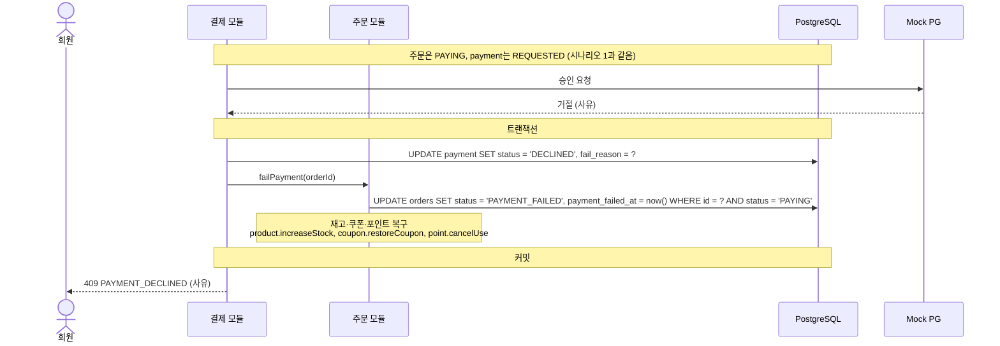
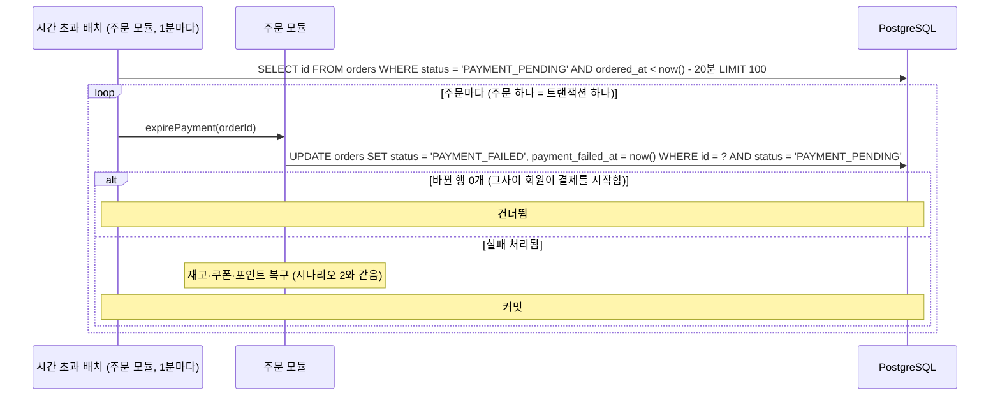
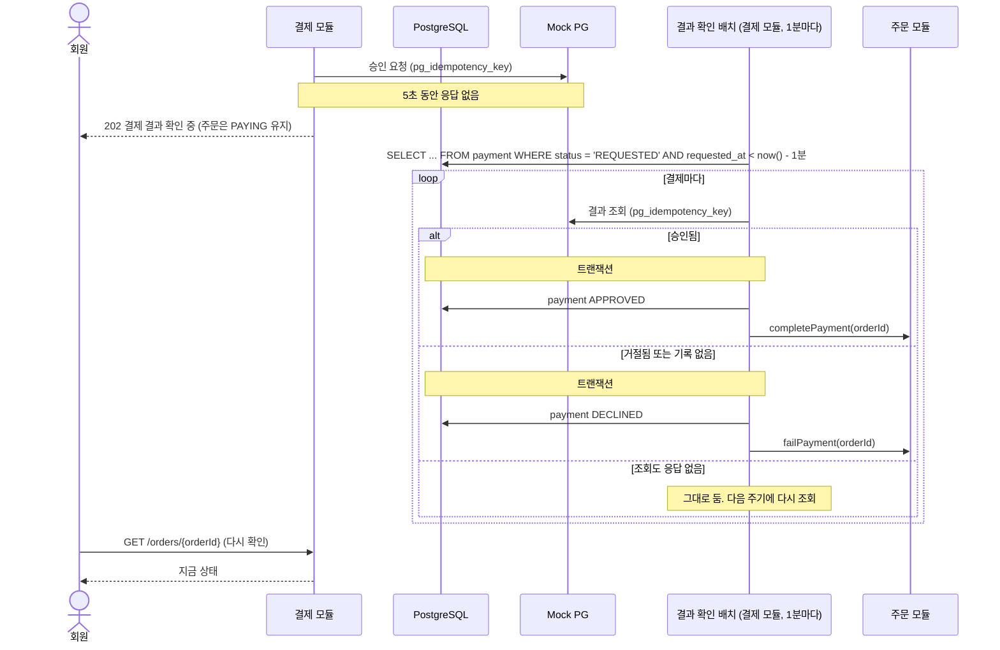
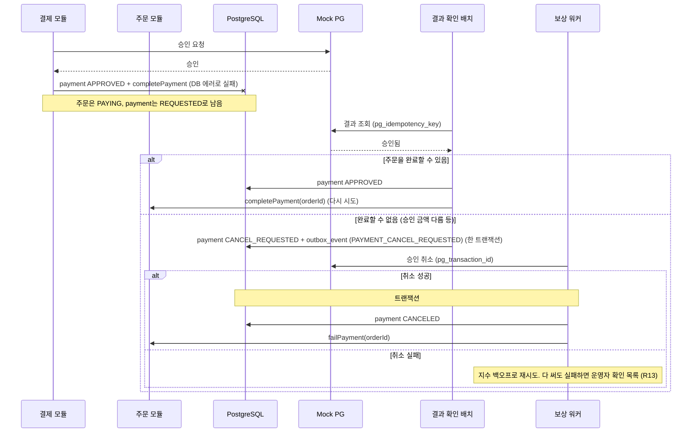
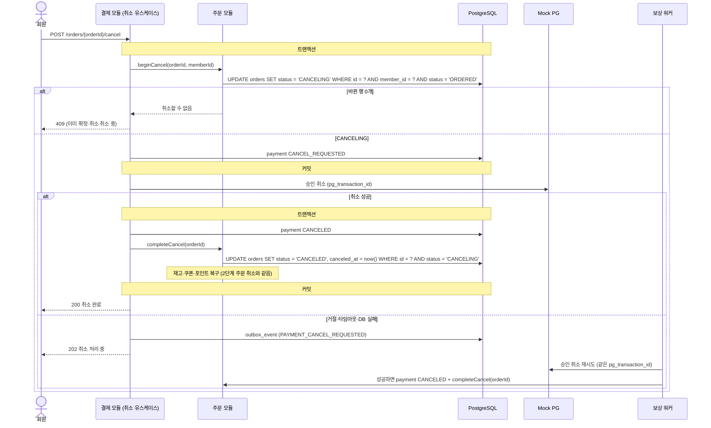

# 결제: Flow

> 3단계 초안이라 상태 값과 `payment` 테이블은 [README의 제안](README.md#erd-제안-초안)을 따릅니다.

모든 시나리오에 Mock PG가 참여합니다. Mock PG는 docker compose 서비스로, 앱과 다른 프로세스에서 띄웁니다. 그래야 네트워크 타임아웃이 실제로 일어납니다 (가정, 구현 시 확정).

## 공통 규칙

| 규칙 | 이유 |
|---|---|
| 결제 모듈은 `orders`를 직접 바꾸지 않습니다. 주문 상태 변경과 재고·쿠폰·포인트 복구는 [주문 모듈의 공개 서비스](README.md#order-모듈에-필요한-공개-서비스-제안)를 부릅니다 | 테이블은 소유 모듈만 씁니다 ([ADR-0002](../../adr/0002-modular-monolith-with-one-port.md)). 복구 순서와 잠금 순서는 주문 모듈 한 곳이 지킵니다 |
| 모듈 의존은 결제에서 주문으로 가는 한 방향이고, 주문 모듈은 결제 모듈을 부르지 않습니다 | 순환 의존을 만들지 않으려는 것입니다. 그래서 3단계의 결제된 주문 취소(시나리오 6)는 결제 모듈의 유스케이스가 맡습니다 |
| 결제사 호출은 DB 트랜잭션 밖에서 합니다 | 결제사 응답을 기다리는 동안 DB 커넥션과 행 잠금을 붙잡지 않습니다 |
| 결제사 호출 전에 상태를 먼저 바꾸고 커밋합니다 (`PAYMENT_PENDING → PAYING`, `ORDERED → CANCELING`) | 호출 도중 서버가 죽어도 "결제사에 무언가를 보냈다"는 흔적이 DB에 남고, 결과 확인 배치가 그 흔적을 보고 마무리합니다 |
| 결제사에는 항상 `pg_idempotency_key`를 보냅니다 | 같은 승인을 다시 보내도 결제사가 한 번만 승인합니다. 결과를 모를 때는 이 키로 조회합니다 |
| 결과를 모르면 실패로 처리하지 않습니다 | 실패로 처리해 재고를 풀었는데 실제로는 승인됐다면 돈만 나갑니다 (`R14`) |
| 승인 뒤에는 먼저 다시 시도하고, 완료할 수 없을 때만 승인을 취소합니다 | 승인 결과는 결제사에 남아 있으므로, 보상인 승인 취소는 마지막 수단입니다 (`R13`) |

주문 모듈 서비스가 하는 일은 [README의 표](README.md#order-모듈에-필요한-공개-서비스-제안)에 있고, 아래 그림의 `O`가 그 서비스입니다.

---

## 시나리오 1. 주문 후 결제 승인

- 같은 결제 요청이 두 번 오면 두 번째는 `startPayment`의 조건부 UPDATE에서 막혀서, 결제사에는 한 번만 요청이 갑니다.
- 20분 조건을 UPDATE에 같이 넣어서, 시간 초과 배치가 아직 돌지 않았어도 20분이 지난 주문은 결제할 수 없습니다.

---

## 시나리오 2. 결제 거절

- 복구는 2단계 주문 취소와 같은 서비스를 같은 순서로 부릅니다 ([주문 Flow](../order/flows.md), [포인트 Flow](../point/flows.md#시나리오-4-주문-취소로-포인트-돌려받기)). 주문의 다음 상태가 `CANCELED`가 아니라 `PAYMENT_FAILED`라는 점만 다릅니다.
- 포인트 사용 취소 내역(`USE_CANCEL`)은 주문당 하나라서, 결제 실패로 한 번 복구된 주문을 다시 복구하지 않습니다.

---

## 시나리오 3. 주문 후 20분 안에 결제하지 않음

결제사가 끼지 않으므로 이 배치는 주문 모듈에 둡니다.

- 주문마다 트랜잭션을 따로 엽니다. 하나가 실패해도 나머지는 처리되고, 실패한 주문은 다음 주기에 다시 잡힙니다.
- 배치를 여러 서버에서 동시에 돌려도 조건부 UPDATE 덕분에 한 주문은 한 번만 처리됩니다.
- `ix_orders_payment_pending` 부분 인덱스로 찾습니다.

---

## 시나리오 4. 승인 요청의 응답을 받지 못함

관련 Risk: `R14`

- 결과 확인 배치는 결제 모듈이 가진 `payment` 테이블만 읽습니다. 주문 상태는 주문 모듈 서비스로만 바꿉니다.
- "기록 없음"은 결제사가 우리 요청을 받지 못했다는 뜻입니다. 같은 키로 승인이 나중에 도착할 수 없도록, Mock PG는 조회한 키를 "닫힘"으로 표시합니다 (가정. 실제 PG는 결제사마다 다릅니다).
- 30분이 넘게 `PAYING`인 주문은 운영자 확인 목록에 올립니다 (가정).

---

## 시나리오 5. 승인은 됐는데 주문 처리가 실패

관련 Risk: `R13`

#### 보상 표

| 실패 지점 | 돈 | 재고·쿠폰·포인트 | 처리 |
|---|---|---|---|
| 승인 요청 전 서버 죽음 (`PAYING` 커밋 뒤) | 안 나감 | 예약됨 | 결과 확인 배치가 조회해서 "기록 없음"이면 `failPayment`, 복구 |
| 승인 요청 중 타임아웃 | 모름 | 예약됨 | 시나리오 4 |
| 승인 뒤 DB 처리 실패 | 나감 | 예약됨 | 결과 확인 배치가 조회해서 승인됨이면 `completePayment` 다시 시도 |
| 승인 금액이 주문 금액과 다름 | 나감 | 예약됨 | 승인 취소(보상) 뒤 `failPayment`, 복구 |
| 승인 취소 실패 | 나감 | 예약됨 | outbox로 재시도. 끝까지 실패하면 운영자 (`R13`) |
| 결제 취소 성공 뒤 DB 처리 실패 | 결제 취소됨 | 차감 상태 | 시나리오 6 워커가 DB 처리만 다시 합니다 |

---

## 시나리오 6. 결제된 주문 취소

3단계에서는 결제된 주문의 취소에 결제 취소가 필요합니다. 모듈 의존이 결제에서 주문으로 가는 한 방향이라, `POST /orders/{orderId}/cancel`은 3단계부터 결제 모듈의 유스케이스가 처리합니다 (제안).

- Mock PG는 같은 결제사 거래 ID의 취소를 여러 번 받아도 한 번만 처리해서, 워커가 마음 놓고 재시도할 수 있습니다.
- `CANCELING`인 동안 구매 확정(`WHERE status = 'ORDERED'`)은 실패하므로, 확정과 취소가 동시에 일어나지 않습니다.
- 결제 취소가 끝까지 거절되면(예: 결제사 정책) 운영자 확인 목록에 올립니다. 주문을 `ORDERED`로 되돌릴지는 3단계에서 정합니다.

---

[이전: 결제](README.md) | [문서 지도](../../README.md) | [다음: API](api.md)
