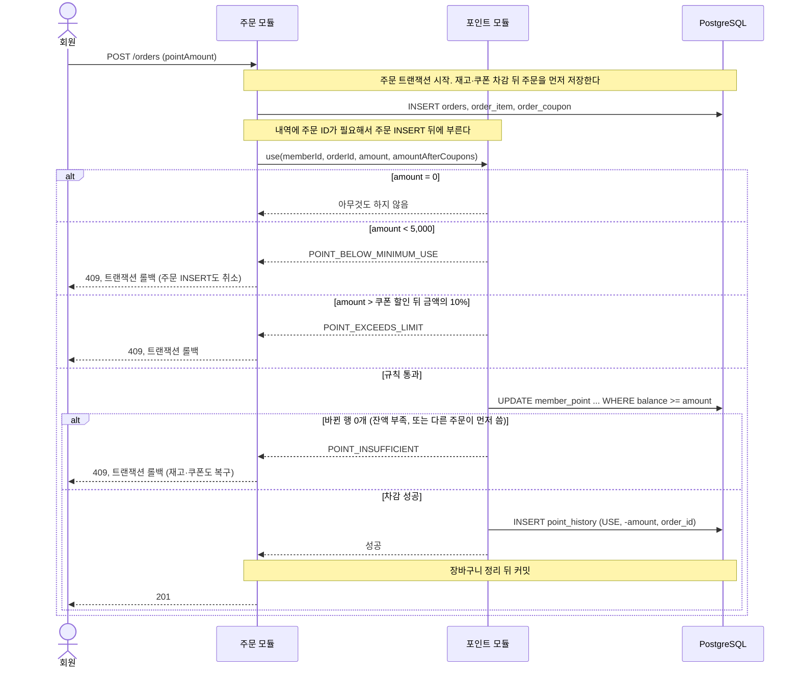
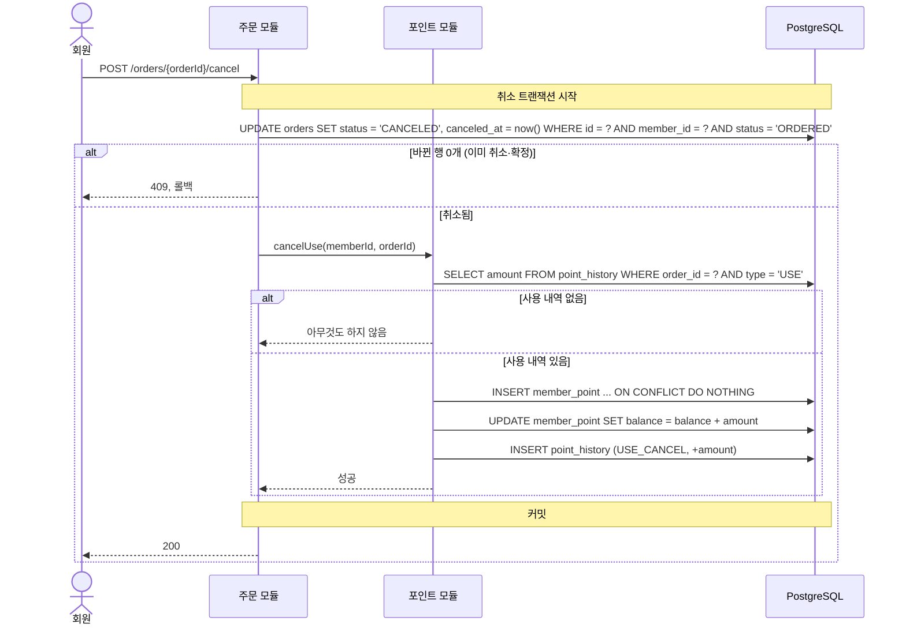
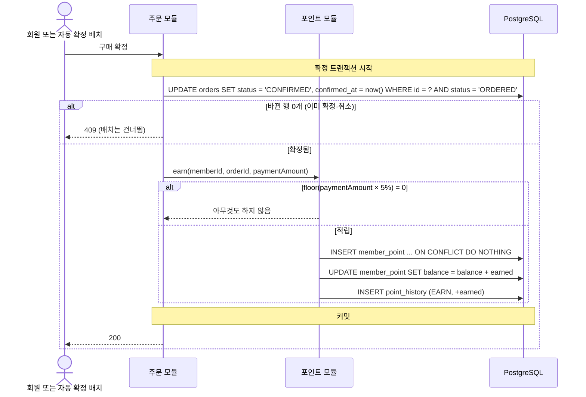
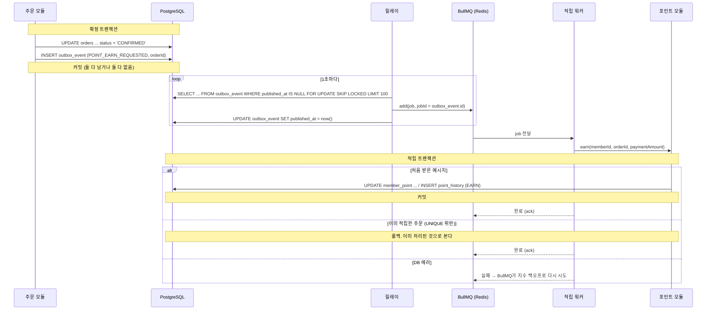

# 포인트: Flow

Risk가 있거나 여러 모듈이 엮이는 흐름만 그립니다. 잔액·내역 조회(시나리오 1, 2)는 DB를 한 번 읽는 것뿐이라 그리지 않습니다.

## 공통: 잔액과 내역은 한 트랜잭션에서 함께 바꾼다

모든 변경은 아래 두 문장을 같은 트랜잭션에서 실행합니다. 그래서 `balance = SUM(point_history.amount)`가 항상 성립합니다.

```sql
-- 1) 잔액을 조건부로 바꾸고, 바뀐 잔액을 돌려받는다
UPDATE member_point
   SET balance = balance + :delta, updated_at = now()
 WHERE member_id = :memberId
   AND balance + :delta >= 0
RETURNING balance;

-- 2) 돌려받은 잔액을 balance_after로 내역을 남긴다
INSERT INTO point_history (member_id, type, amount, balance_after, order_id, created_at)
VALUES (:memberId, :type, :delta, :balance, :orderId, now());
```

- 사용은 `delta < 0`입니다. 바뀐 행이 0개면 잔액 부족입니다 (`R11`).
- 적립·사용 취소는 `delta > 0`입니다. 잔액 행이 없을 수 있어서, 먼저 `INSERT INTO member_point (member_id, balance) VALUES (:memberId, 0) ON CONFLICT (member_id) DO NOTHING`을 실행합니다.
- `findOne` → 잔액 계산 → `save()`는 쓰지 않습니다. 동시에 두 주문이 같은 잔액을 읽으면 하나의 차감이 사라집니다. 이 방식은 `R11` 실험의 Before 구현에서만 씁니다.
- 내역 INSERT가 `uq_point_history_order_type`에 걸리면 트랜잭션 전체가 롤백됩니다. 잔액도 함께 원래대로 돌아갑니다.

---

## 시나리오 3. 주문에 포인트 쓰기

관련 Risk: `R11`

주문 트랜잭션의 일부입니다. 재고·쿠폰 차감은 [주문 Flow](../order/flows.md)에 있습니다.



**동시에 두 주문이 같은 잔액을 쓸 때** (`R11`)

잔액 10,000, 주문 A와 B가 각각 6,000을 씁니다.

| 순서 | 주문 A | 주문 B |
|---|---|---|
| 1 | `UPDATE ... WHERE balance >= 6000` → 행 잠금, 잔액 4,000 | |
| 2 | | 같은 UPDATE → A의 잠금을 기다림 |
| 3 | 커밋 | |
| 4 | | 잠금을 얻고 조건을 다시 확인 → 4,000 < 6,000 → 바뀐 행 0개 → `POINT_INSUFFICIENT`, 롤백 |

PostgreSQL은 기다리던 UPDATE가 잠금을 얻으면 바뀐 행을 다시 읽어 WHERE를 다시 확인합니다 (READ COMMITTED). 그래서 조건부 UPDATE 한 문장으로 잔액 0 미만을 막습니다. CHECK `balance >= 0`이 마지막 방어선입니다.

**실패 시 처리**

| 실패 | 처리 | 회원이 보는 것 |
|---|---|---|
| 규칙 위반 (5,000 미만, 10% 초과) | 도메인 에러. 주문 트랜잭션 롤백 | 409 |
| 잔액 부족 | 바뀐 행 0개 → 도메인 에러. 롤백 | 409 `POINT_INSUFFICIENT` |
| 내역 INSERT 실패 (일시적 DB 실패: 연결 오류, 잠금 대기 초과 등) | 롤백. 주문과 잔액도 원래대로 | 503 `ORDER_RETRY` |

---

## 시나리오 4. 주문 취소로 포인트 돌려받기

취소 트랜잭션의 일부입니다. 재고·쿠폰 복구는 [주문 Flow](../order/flows.md)에 있습니다.



- 되돌릴 금액은 `orders.point_amount`가 아니라 그 주문의 `USE` 내역에서 읽습니다. 실제로 차감된 금액이 기준입니다. 두 값은 주문 트랜잭션에서 함께 기록돼서 같아야 합니다.
- 같은 주문의 `USE_CANCEL`은 `uq_point_history_order_type`이 하나만 허용합니다. 주문 상태 조건이 먼저 막고, 이 UNIQUE가 한 번 더 막습니다.

---

## 시나리오 5. 구매 확정으로 포인트 적립

관련 Risk: `R12`

### 2단계: 확정과 같은 트랜잭션에서 적립



- 확정 처리가 두 번 실행되면 두 번째는 주문 상태 조건(`WHERE status = 'ORDERED'`)에서 막힙니다.
- 혹시 그 조건을 지나도 `EARN` 내역 INSERT가 `uq_point_history_order_type`에 걸려서 트랜잭션 전체가 롤백됩니다 (`R12`).

### 3단계: outbox와 워커로 비동기 적립

확정 트랜잭션은 주문 상태와 "적립할 것" 기록만 함께 커밋합니다. 포인트는 워커가 따로 쌓습니다.
프로세스 안 이벤트(`@nestjs/event-emitter`)는 쓰지 않습니다. 커밋 직후 서버가 죽으면 이벤트가 사라집니다 ([개발 규칙](../../reference/conventions.md#하지-않는-것)).



**같은 메시지가 두 번 오는 경우** (`R12`)

| 상황 | 결과 |
|---|---|
| 릴레이가 큐에 넣은 뒤 `published_at`을 쓰기 전에 죽음 | 다음 릴레이가 같은 행을 다시 넣는다. BullMQ는 같은 `jobId`를 한 번만 받는다. 이미 처리가 끝나 job이 지워졌다면 다시 들어올 수 있다 |
| 워커가 적립을 커밋한 뒤 ack 전에 죽음 | BullMQ가 같은 job을 다시 준다 |
| 어느 경우든 | `uq_point_history_order_type`이 두 번째 `EARN`을 막는다. 워커는 UNIQUE 위반을 성공으로 보고 ack한다 |

- 큐 도구는 BullMQ를 추천합니다. 이미 Redis를 쓰고, 재시도·지연·실패 목록을 기본으로 줍니다. Redis Streams는 소비자 그룹과 미처리 메시지 회수를 직접 만들어야 합니다. 최종 선택은 3단계 구현 때 정합니다 (구현 시 확정).
- 큐는 "더 빨리 전달하는 길"일 뿐입니다. 기준은 outbox 테이블입니다. 큐 데이터가 사라져도 `published_at`을 비우면 다시 보낼 수 있습니다.
- 재시도를 다 써도 실패한 job은 실패 목록에 남깁니다. 운영자가 원인을 고친 뒤 다시 넣습니다.

**outbox 테이블 (ERD 제안, 3단계 초안)**

[ERD](../../reference/erd.md)에는 아직 없습니다. 3단계를 설계할 때 추가합니다.

| 컬럼 | 타입 | 제약 |
|---|---|---|
| id | bigint | PK |
| event_type | varchar(50) | NOT NULL. 예: `POINT_EARN_REQUESTED` |
| aggregate_id | bigint | NOT NULL. 예: 주문 ID |
| payload | jsonb | NOT NULL. 예: `{ memberId, orderId, paymentAmount }` |
| published_at | timestamptz | NULL. 큐에 넣은 시각 |
| created_at | timestamptz | NOT NULL |

- `uq_outbox_event_type_aggregate`: `UNIQUE(event_type, aggregate_id)`. 한 주문에 적립 요청은 하나다.
- `ix_outbox_event_unpublished`: `(id) WHERE published_at IS NULL`. 릴레이가 보낼 행을 찾는다.
- 다 보낸 행을 지울지, 보관 기간을 둘지는 3단계에서 정합니다.

**모든 확정 주문이 결국 적립되었는지 확인**

```sql
-- 확정됐는데 적립 내역이 없는 주문 (결제 금액의 5%가 0인 주문은 제외)
SELECT o.id
  FROM orders o
  LEFT JOIN point_history h ON h.order_id = o.id AND h.type = 'EARN'
 WHERE o.status = 'CONFIRMED'
   AND o.payment_amount >= 20
   AND o.confirmed_at < now() - interval '5 minutes'
   AND h.id IS NULL;
```

이 쿼리 결과는 0건이어야 합니다. 3단계 부하 테스트 뒤 검증 쿼리로 씁니다.

---

[← 이전: 포인트](README.md) | [문서 지도](../../README.md) | [다음: API →](api.md)
