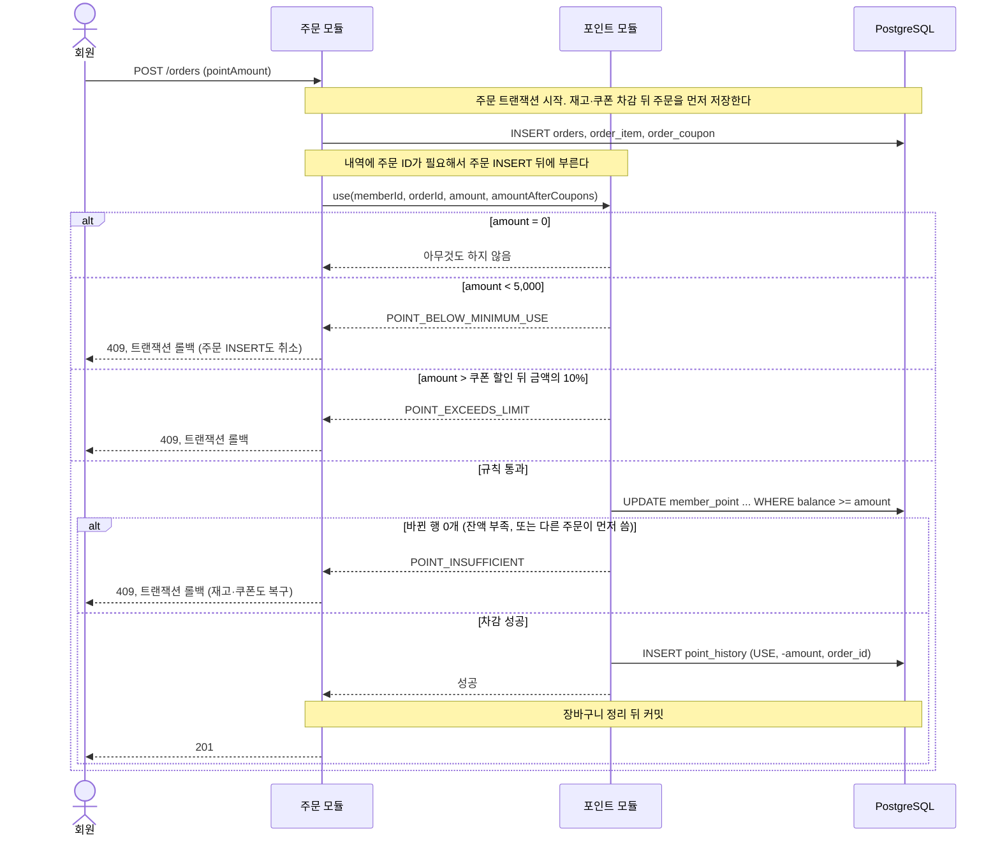
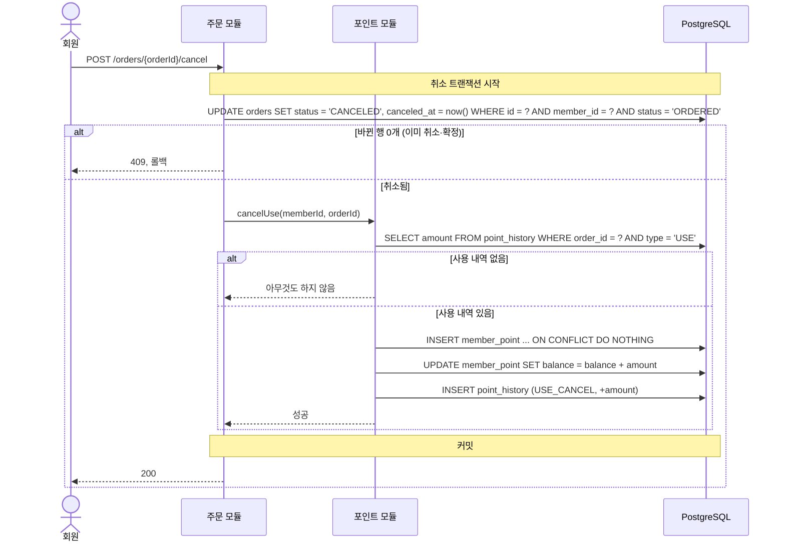
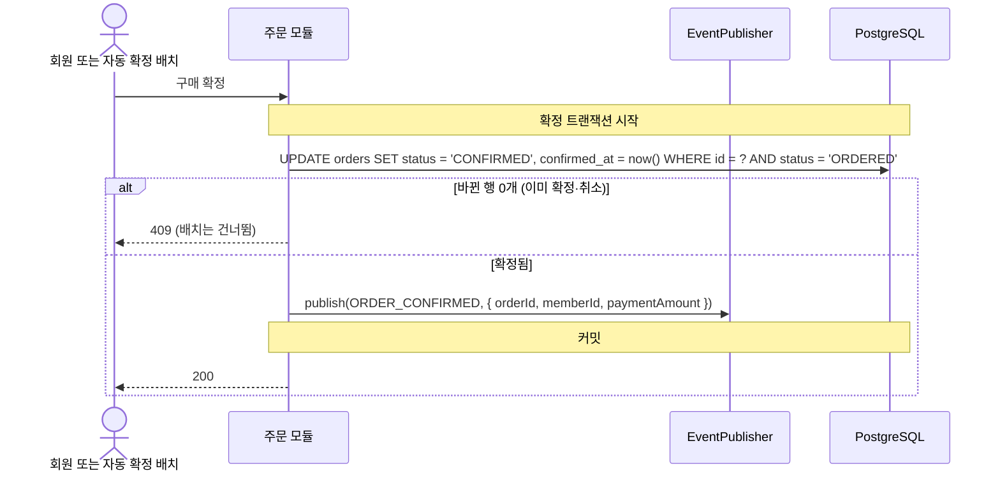
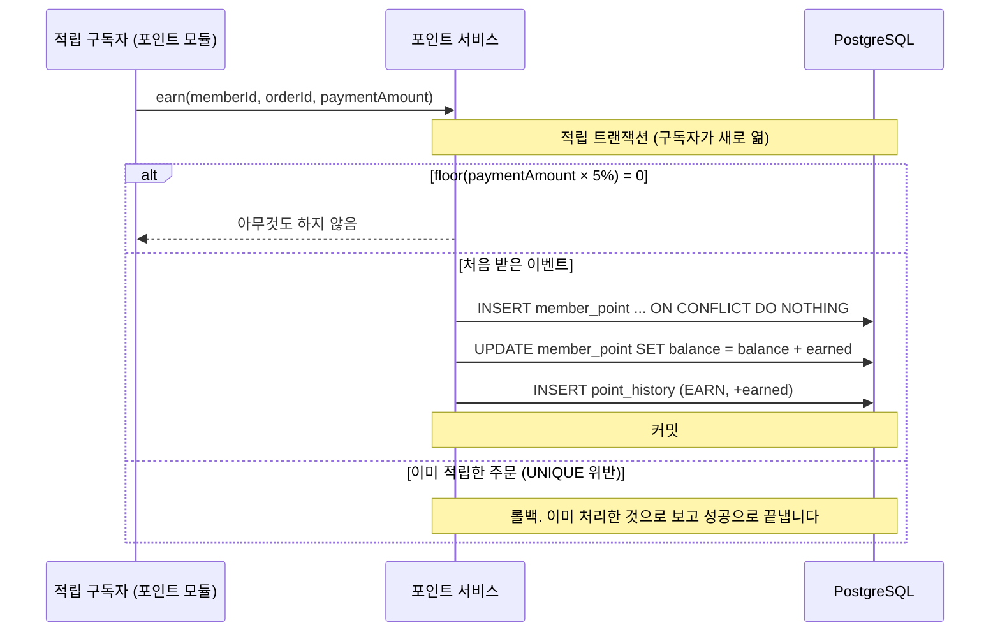
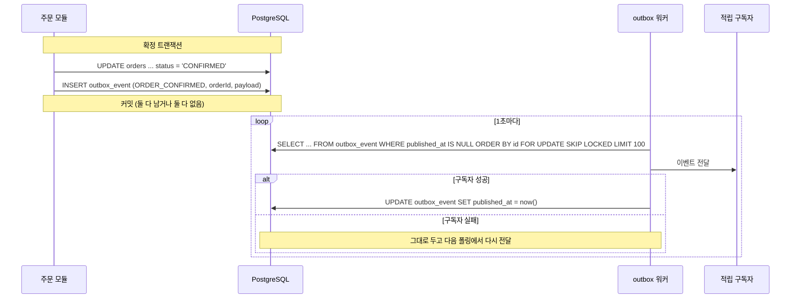
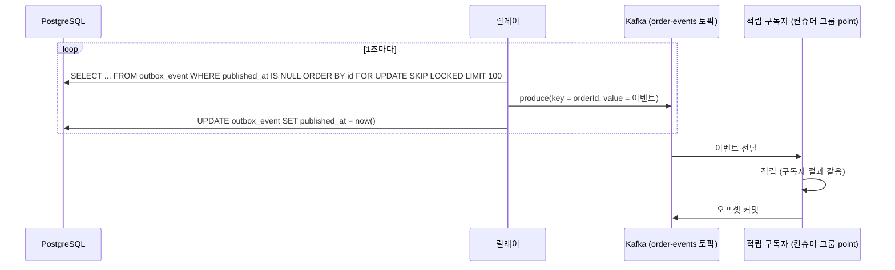

# 포인트: Flow

Risk가 있거나 여러 모듈이 엮이는 흐름만 그립니다. 포인트 잔액 보기와 포인트 내역 보기는 DB를 한 번 읽는 것뿐이라 그리지 않습니다.

## 공통: 잔액과 내역은 한 트랜잭션에서 함께 바꾼다

모든 변경은 아래 두 문장을 같은 트랜잭션에서 실행해서 `balance = SUM(point_history.amount)`가 항상 성립합니다.

```sql
-- 1) 잔액을 조건부로 바꾸고, 바뀐 잔액을 돌려받는다
UPDATE member_point
   SET balance = balance + :delta, updated_at = now()
 WHERE member_id = :memberId
   AND balance + :delta >= 0
RETURNING balance;

-- 2) 돌려받은 잔액을 balance_after로 내역을 남긴다
INSERT INTO point_history (member_id, type, amount, balance_after, order_id, created_at)
VALUES (:memberId, :type, :delta, :balance, :orderId, now());
```

- 사용은 `delta < 0`입니다. 바뀐 행이 0개면 잔액 부족입니다 (포인트 이중 사용).
- 적립·사용 취소는 `delta > 0`입니다. 잔액 행이 없을 수 있어서, 먼저 `INSERT INTO member_point (member_id, balance) VALUES (:memberId, 0) ON CONFLICT (member_id) DO NOTHING`을 실행합니다.
- `findOne`으로 읽고 잔액을 계산해서 `save()`하는 방식은 쓰지 않습니다. 동시에 두 주문이 같은 잔액을 읽으면 차감 하나가 사라지므로, 이 방식은 포인트 동시 사용 실험의 Before 구현에서만 씁니다.
- 내역 INSERT가 `uq_point_history_order_type`에 걸리면 트랜잭션 전체가 롤백되고, 잔액도 함께 원래대로 돌아갑니다.

---

## 시나리오 3. 주문에 포인트 쓰기

관련 Risk: 포인트 이중 사용

주문 트랜잭션의 일부입니다. 재고·쿠폰 차감은 [주문 Flow](../order/flows.md)에 있습니다.



#### 동시에 두 주문이 같은 잔액을 쓸 때

잔액 10,000, 주문 A와 B가 각각 6,000을 씁니다.

| 순서 | 주문 A | 주문 B |
|---|---|---|
| 1 | `UPDATE ... WHERE balance >= 6000`으로 행 잠금, 잔액 4,000 | |
| 2 | | 같은 UPDATE, A의 잠금 대기 |
| 3 | 커밋 | |
| 4 | | 잠금을 얻고 조건을 다시 확인. 4,000 < 6,000이라 바뀐 행 0개, `POINT_INSUFFICIENT`로 롤백 |

PostgreSQL은 기다리던 UPDATE가 잠금을 얻으면 바뀐 행을 다시 읽어 WHERE를 다시 확인합니다 (READ COMMITTED). 그래서 조건부 UPDATE 한 문장으로 잔액 0 미만을 막고, CHECK `balance >= 0`을 마지막 방어선으로 둡니다.

#### 실패 시 처리

| 실패 | 처리 | 회원이 보는 것 |
|---|---|---|
| 규칙 위반 (5,000 미만, 10% 초과) | 도메인 에러. 주문 트랜잭션 롤백 | 409 |
| 잔액 부족 | 바뀐 행 0개라 도메인 에러. 롤백 | 409 `POINT_INSUFFICIENT` |
| 내역 INSERT 실패 (일시적 DB 실패: 연결 오류, 잠금 대기 초과 등) | 롤백. 주문과 잔액도 원래대로 | 503 `ORDER_RETRY` |

---

## 시나리오 4. 주문 취소로 포인트 돌려받기

취소 트랜잭션의 일부입니다. 재고·쿠폰 복구는 [주문 Flow](../order/flows.md)에 있습니다.



- 실제로 차감된 금액이 기준이라서, 되돌릴 금액은 `orders.point_amount`가 아니라 그 주문의 `USE` 내역에서 읽습니다. 두 값은 주문 트랜잭션에서 함께 기록되므로 같아야 합니다.
- 같은 주문의 `USE_CANCEL`은 `uq_point_history_order_type`이 하나만 허용합니다. 주문 상태 조건이 먼저 막고, 이 UNIQUE가 한 번 더 막습니다.

---

## 시나리오 5. 구매 확정으로 포인트 적립

관련 Risk: 포인트 적립 누락, 포인트 이중 적립

주문 모듈은 확정만 하고 구매 확정됨(`ORDER_CONFIRMED`) 이벤트를 발행합니다. 포인트 모듈의 구독자가 그 이벤트를 받아 적립합니다.
전달 방식은 [모듈 사이 반응은 이벤트로](../../adr/0003-module-reactions-through-events.md) 순서대로 프로세스 안, outbox, Kafka로 바꾸고, 발행 코드와 구독자 코드는 그대로 둡니다.

### 확정과 발행



- 확정 처리가 두 번 실행되면 두 번째는 주문 상태 조건(`WHERE status = 'ORDERED'`)에서 막히고, 이벤트도 다시 나가지 않습니다.
- `publish`는 전달 방식과 상관없이 늘 트랜잭션 안의 이 자리에서 부릅니다. 실제로 무엇을 하는지는 전달 방식마다 다르고, 아래 세 절에 있습니다.
- 봉투(`eventId`, `type`, `occurredAt`)는 `EventPublisher`가 채웁니다 ([이벤트 계약](../../adr/0003-module-reactions-through-events.md#이벤트-계약)).

### 구독자: 이벤트를 받아 적립



- 같은 이벤트가 두 번 와도 `uq_point_history_order_type`이 두 번째 `EARN`을 막습니다 (포인트 이중 적립).
- 구독자는 `@EventHandler('ORDER_CONFIRMED')`로 등록하고, 주문 모듈 대신 `shared/event/contracts/`의 계약만 import합니다. 이벤트에 담긴 값만 씁니다.
- 구독자는 CLS 컨텍스트와 트랜잭션을 새로 엽니다. 발행한 쪽의 트랜잭션에 섞이지 않습니다.

### 전달 1. 프로세스 안 이벤트 (Before)

프로세스 안 구현은 `publish`된 이벤트를 CLS에 모아 두었다가, 확정 요청이 성공으로 끝난 뒤 `@nestjs/event-emitter`로 내보냅니다. 서버 메모리 안에서만 전달됩니다.
이 방식으로 아래 한계를 재현하고 기록합니다.

| 해 볼 것 | 예상 결과 |
|---|---|
| 트랜잭션 안에서 바로 내보내는 Before 구현 | 구독자가 확정 트랜잭션에 섞이거나, 롤백된 확정에 반응합니다. 어느 쪽인지는 실험으로 확인합니다 (미검증) |
| 커밋 뒤 내보내기 직전에 서버 종료 (`FAULT_POINT=after-commit-before-publish`) | 확정됐는데 적립이 없는 주문이 생깁니다 (포인트 적립 누락) |
| 구독자에서 예외 | 로그만 남고 다시 시도하지 않아서, 역시 적립이 빠집니다 |

### 전달 2. outbox와 폴링 워커

`publish`는 확정과 같은 트랜잭션에서 `outbox_event`에 행을 넣기만 합니다. 커밋되면 확정과 이벤트가 함께 남고, 롤백되면 함께 사라집니다.



| 상황 | 결과 |
|---|---|
| 구독자가 적립을 커밋한 뒤, 워커가 `published_at`을 쓰기 전에 죽음 | 다음 폴링에서 같은 이벤트가 다시 갑니다. UNIQUE가 두 번째 적립을 막습니다 |
| 워커가 두 대 | `FOR UPDATE SKIP LOCKED`로 같은 행을 동시에 잡지 않습니다 |

이 방식으로 만날 한계도 기록합니다. 아래 두 가지는 outbox를 만드는 작업에서 정합니다.

- 워커 트랜잭션을 어떻게 나눌지: 지금 그림처럼 100건을 한 트랜잭션으로 잡으면 구독자 실패 한 건이 묶음 전체를 되돌릴 수 있습니다. 행마다 나누는 방법과 비교해 정합니다.
- 계속 실패하는 이벤트를 몇 번까지 다시 보낼지와, 실패 횟수를 어디에 남길지.

그 밖의 한계입니다.

- 폴링 간격만큼 적립이 늦고, 요청이 몰리면 보내지 않은 행이 쌓입니다.
- 계속 실패하는 이벤트가 있으면 같은 행을 매번 다시 잡습니다.
- 구독자가 늘면 워커 하나가 모든 구독자를 불러야 하고, 하나만 실패해도 그 이벤트를 다시 보내야 합니다. 구독자마다 따로 받고 따로 다시 시도하려고 Kafka로 넘어갑니다.

### 전달 3. outbox와 Kafka

outbox에 넣는 것은 전달 2와 같고, 워커 대신 릴레이가 Kafka 토픽으로 보냅니다. 구독자는 Kafka 컨슈머 그룹으로 받습니다.



- 같은 주문의 이벤트는 같은 키라서 같은 파티션으로 가고, 그 안에서만 순서가 지켜집니다.
- 릴레이가 보낸 뒤 `published_at`을 쓰기 전에 죽거나, 컨슈머가 적립을 커밋한 뒤 오프셋을 커밋하기 전에 죽으면 같은 이벤트가 다시 옵니다. 여기서도 UNIQUE가 막습니다.
- 처리하지 못하는 메시지가 파티션의 뒤를 막는 문제, 컨슈머가 바뀌는 동안 생기는 중복, 부하 때 밀린 메시지 수(lag)를 실험으로 잽니다.
- Kafka 버전과 클라이언트 라이브러리는 붙일 때 정합니다 (구현 시 확정).

`outbox_event` 테이블은 [ERD](../../reference/erd.md#outbox_event-이벤트-보관함)에 있습니다.

### 모든 확정 주문이 결국 적립되었는지 확인

```sql
-- 확정됐는데 적립 내역이 없는 주문 (결제 금액의 5%가 0인 주문은 제외)
SELECT o.id
  FROM orders o
  LEFT JOIN point_history h ON h.order_id = o.id AND h.type = 'EARN'
 WHERE o.status = 'CONFIRMED'
   AND o.payment_amount >= 20
   AND o.confirmed_at < now() - interval '5 minutes'
   AND h.id IS NULL;
```

이 쿼리 결과는 0건이어야 합니다. 전달 방식마다 부하 테스트가 끝나면 이 쿼리로 포인트 적립 누락을 셉니다.

---

[이전: 포인트](README.md) | [문서 지도](../../README.md) | [다음: API](api.md)
