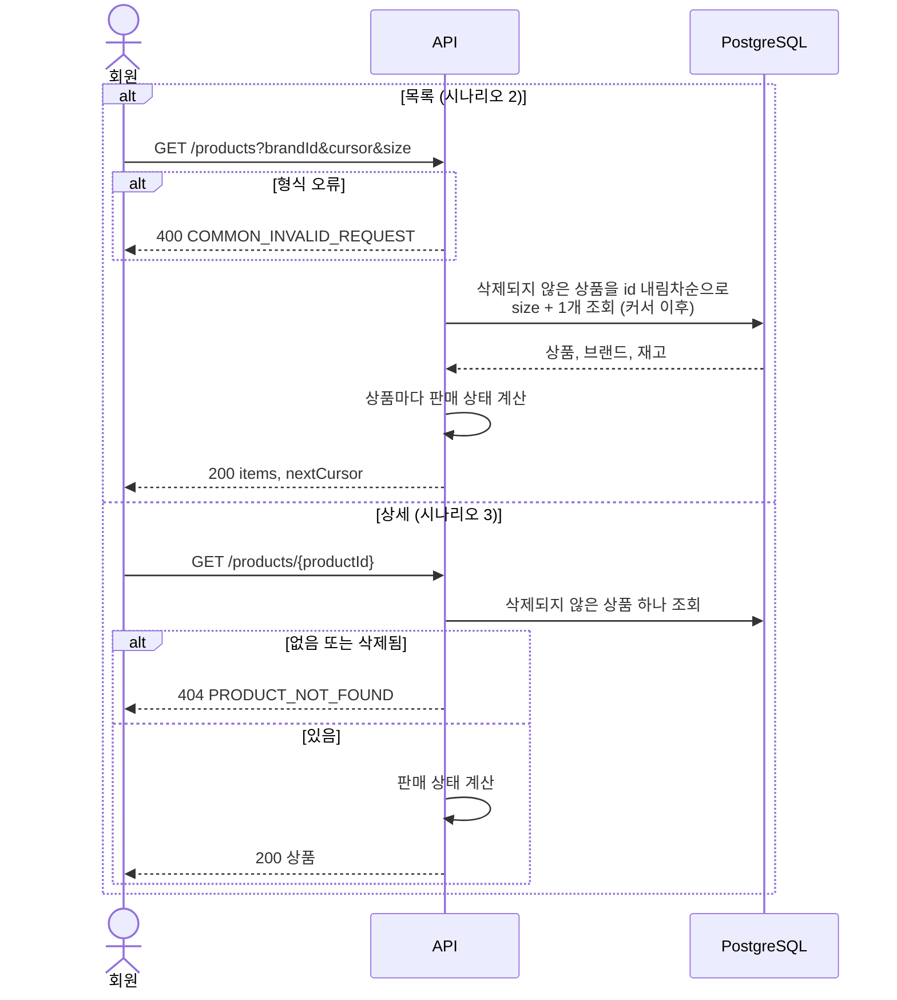
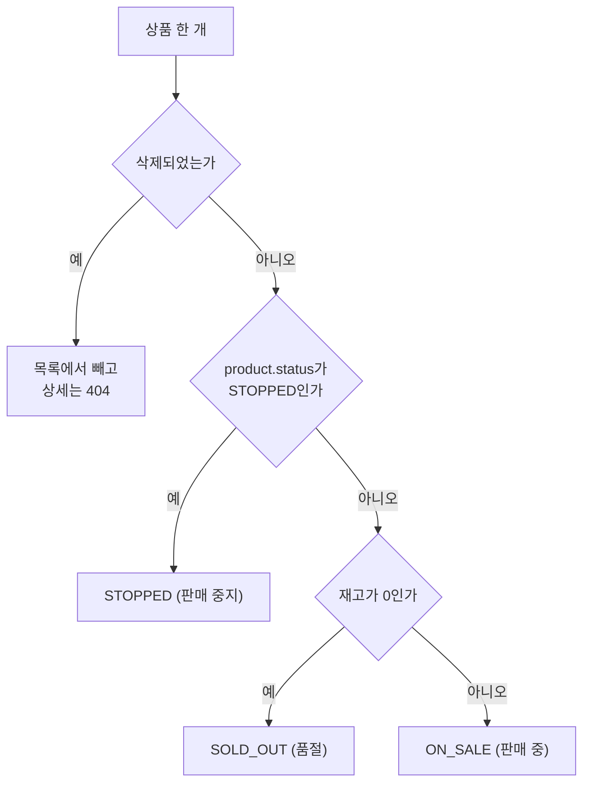
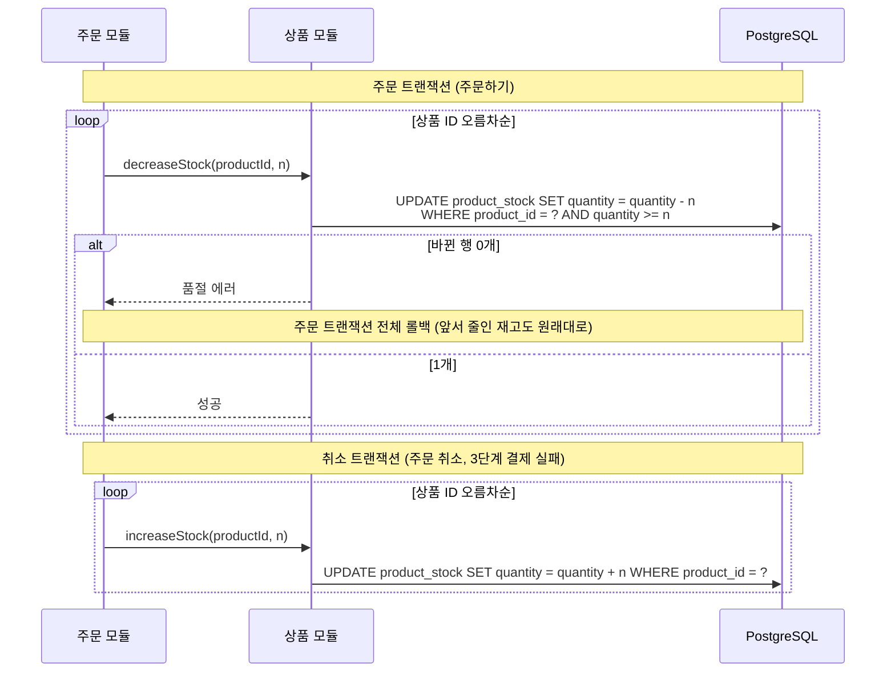

# 상품: Flow

회원이 쓰는 상품 API는 조회뿐이라 트랜잭션이 없습니다. 목록과 상세는 같은 흐름이라 다이어그램 하나로 그리고, 판매 상태 계산을 따로 그립니다.
재고 차감·복구는 주문 모듈이 상품 모듈의 공개 서비스로 부르며, [마지막 절](#재고-차감과-복구-다른-모듈이-부름)에 있습니다.

## 시나리오 1. 브랜드 목록 보기

```sql
SELECT id, name
FROM brand
ORDER BY name;
```

브랜드는 수가 적고 지우지 않습니다. 페이지 없이 전체를 한 번에 줍니다.

## 시나리오 2, 3. 상품 목록·상세 보기



목록 SQL입니다. `brandId`가 없으면 브랜드 조건을 뺍니다.

```sql
SELECT p.id, p.name, p.price, p.status,
       b.id AS brand_id, b.name AS brand_name,
       s.quantity AS stock_quantity
FROM product p
JOIN brand b ON b.id = p.brand_id
JOIN product_stock s ON s.product_id = p.id
WHERE p.deleted_at IS NULL
  AND (:brandId IS NULL OR p.brand_id = :brandId)
  AND (:cursorId IS NULL OR p.id < :cursorId)
ORDER BY p.id DESC
LIMIT :size + 1;
```

- `size + 1`개를 읽어서, 하나가 더 있으면 다음 페이지가 있다고 판단합니다. `nextCursor`는 마지막으로 응답한 상품 ID를 감싼 불투명한 문자열입니다.
- `deleted_at IS NULL`을 직접 적습니다. 직접 쓴 SQL에는 TypeORM의 soft delete 필터가 붙지 않습니다 ([ERD 삭제 정책](../../reference/erd.md#삭제-정책)).
- 브랜드로 거를 때는 `ix_product_brand_id`를 씁니다.
- `stock_quantity`는 판매 상태 계산에만 쓰고 응답에 넣지 않습니다.
- 재고 행은 주문이 몰릴 때 계속 잠기지만, PostgreSQL의 일반 SELECT는 행 잠금을 기다리지 않습니다. 그래서 상품 조회는 주문과 부딪히지 않습니다.

## 판매 상태 계산



이 계산은 `src/product/domain/`의 순수 함수 하나에 둡니다. 장바구니 보기도 같은 함수를 씁니다.

## 재고 차감과 복구 (다른 모듈이 부름)

관련 Risk: `R6`, `R8` (주문 기능이 소유)

주문 트랜잭션 안에서 주문 모듈이 부릅니다. 상품 모듈은 트랜잭션을 열지 않고, 부른 쪽의 트랜잭션에 참여합니다.



- 조건부 UPDATE 한 문장이라 읽고 나서 쓰는 틈이 없습니다. 기다리던 UPDATE는 잠금을 얻은 뒤 조건을 다시 확인합니다 (PostgreSQL READ COMMITTED). `ck_product_stock_quantity`(≥ 0)가 마지막 방어선입니다.
- `findOne` → `save()`로 재고를 바꾸는 구현은 실험의 Before로만 씁니다 ([실험 계획](../../experiments/)).

---

[← 이전: 상품](README.md) | [문서 지도](../../README.md) | [다음: API →](api.md)
