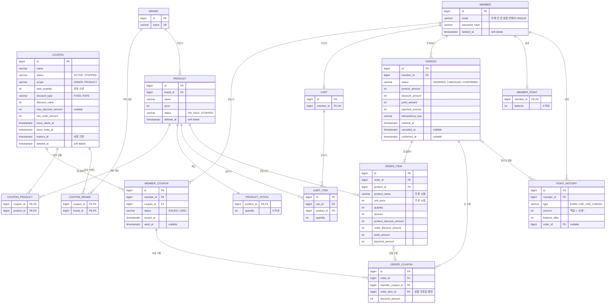
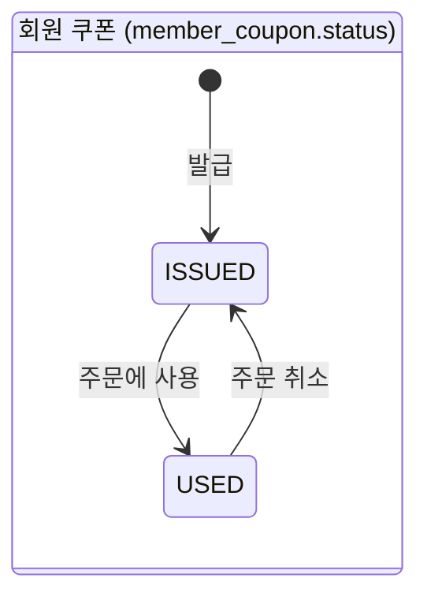
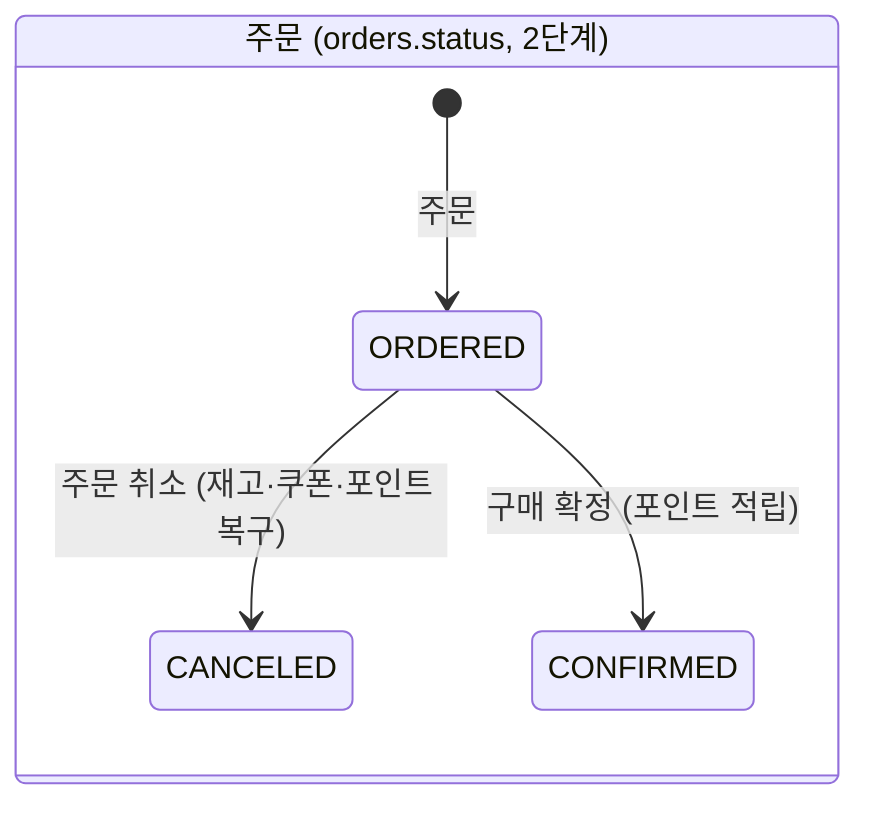

# ERD

테이블은 여러 기능이 같이 쓰므로 ERD는 여기 한 곳에만 두고, 기능 문서에서는 이 문서를 링크합니다.
1·2단계 테이블(포인트 테이블 포함)을 확정했습니다. 포인트 비동기 적립은 3단계입니다. 3단계 결제 테이블은 [결제 기능](../features/payment/)을 설계할 때 추가합니다.

## 한눈에 보기

| 테이블 | 모듈 | 단계 | 한 줄 설명 |
|---|---|---|---|
| [member](#member-회원) | auth | 1 | 회원. 이메일과 비밀번호 해시 |
| [coupon](#coupon-쿠폰) | coupon | 1 | 쿠폰 한 종류. 한정 수량, 할인, 발급 기간, 사용 기한 |
| [member_coupon](#member_coupon-회원-쿠폰) | coupon | 1 | 회원 쿠폰. 1인 1매 |
| [coupon_product](#coupon_product-coupon_brand-상품-쿠폰의-대상) | coupon | 2 | 상품 쿠폰을 쓸 수 있는 상품 |
| [coupon_brand](#coupon_product-coupon_brand-상품-쿠폰의-대상) | coupon | 2 | 상품 쿠폰을 쓸 수 있는 브랜드 |
| [brand](#brand-브랜드) | product | 2 | 브랜드 |
| [product](#product-상품) | product | 2 | 상품. 판매 중지와 삭제를 따로 표현 |
| [product_stock](#product_stock-재고) | product | 2 | 재고 잔액 |
| [cart](#cart-cart_item-장바구니) | cart | 2 | 장바구니. 회원당 1개 |
| [cart_item](#cart-cart_item-장바구니) | cart | 2 | 장바구니 항목 |
| [orders](#orders-주문) | order | 2 | 주문 |
| [order_item](#order_item-주문-상품) | order | 2 | 주문 상품. 주문 시점 이름·가격과 상품별 할인 |
| [order_coupon](#order_coupon-주문에-쓴-쿠폰) | order | 2 | 주문에 쓴 쿠폰 |
| [member_point](#member_point-point_history-포인트) | point | 2 | 포인트 잔액 |
| [point_history](#member_point-point_history-포인트) | point | 2 | 포인트 내역. 추가만 하고 고치지 않음 |

## 다이어그램

다이어그램에서는 모든 테이블에 있는 `created_at`, `updated_at`을 생략했습니다.

## 공통 규칙

| 항목 | 규칙 | 이유 |
|---|---|---|
| PK | `bigint GENERATED ALWAYS AS IDENTITY`. TypeScript에서는 `number` | 외부에 노출해도 되는 ID만 다루는 규모라 UUID의 이점이 작습니다. 10만 명·1만 장 규모라 `number` 안전 범위를 넘지 않습니다 |
| 시각 | 모두 `timestamptz` | 시간대가 다른 서버·클라이언트가 같은 순간을 같은 값으로 봅니다 |
| 금액 | 원 단위 `integer` | 원 미만이 없고 소수 오차도 없습니다 |
| 생성·수정 시각 | 모든 엔티티가 `BaseTimeEntity`(`created_at`, `updated_at`)를 상속합니다. 예외로 `point_history`는 고치지 않는 테이블이라 `created_at`만 둡니다 | 장애를 조사할 때 "언제 바뀌었나"가 필요합니다 |
| FK | 모두 `ON DELETE RESTRICT` | 실수로 부모 행을 지우면 에러가 나서 이력이 끊기지 않습니다 |
| 상태 컬럼 | PostgreSQL enum 대신 `varchar` + CHECK | enum은 값을 추가·삭제하는 마이그레이션이 번거롭습니다 |
| 제약 이름 | `ck_<테이블>_<뜻>`, `uq_<테이블>_<뜻>`, `ix_<테이블>_<컬럼>` | 위반 에러에 어떤 규칙에 걸렸는지가 이름으로 나옵니다 |
| 어디에 규칙을 둘까 | 바뀌지 않는 사실은 DB(UNIQUE, FK, CHECK), 바뀌는 정책은 도메인 클래스 | 정책(예: 정률 1~100%)이 DB에도 있으면 두 곳을 같이 고쳐야 합니다. 사실(예: 기간 순서)은 바뀌지 않아 중복 비용이 없습니다 |
| 테이블을 넘는 규칙 | 도메인 클래스가 검사하고, 테스트로 고정 | CHECK는 다른 테이블을 볼 수 없습니다 |

## 테이블

### member (회원)

| 컬럼 | 타입 | 제약 |
|---|---|---|
| id | bigint | PK |
| email | varchar(255) | NOT NULL |
| password_hash | varchar(255) | NOT NULL |
| created_at, updated_at | timestamptz | NOT NULL |
| deleted_at | timestamptz | NULL. soft delete |

- `uq_member_email_active`: `UNIQUE(email) WHERE deleted_at IS NULL`. 탈퇴한 회원의 이메일로 다시 가입할 수 있습니다.
- 시드: `member{n}@example.com`. 10만 명을 하나씩 해시하면 시드가 오래 걸려서, 모든 시드 회원이 미리 계산한 같은 비밀번호 해시를 씁니다.

### coupon (쿠폰)

| 컬럼 | 타입 | 제약 |
|---|---|---|
| id | bigint | PK |
| name | varchar(100) | NOT NULL |
| status | varchar(10) | NOT NULL, 기본값 `ACTIVE`. `ck_coupon_status`: `ACTIVE`, `STOPPED` |
| scope | varchar(10) | NOT NULL. `ck_coupon_scope`: `ORDER`, `PRODUCT` |
| total_quantity | integer | NOT NULL. `ck_coupon_total_quantity`: > 0 |
| discount_type | varchar(10) | NOT NULL. `ck_coupon_discount_type`: `FIXED`, `RATE` |
| discount_value | integer | NOT NULL. 정액이면 원, 정률이면 % |
| max_discount_amount | integer | NULL. 정률일 때 최대 할인 금액 |
| min_order_amount | integer | NOT NULL, 기본값 0. 기준 금액이 이 값 이상이어야 쓸 수 있습니다 |
| issue_starts_at | timestamptz | NOT NULL |
| issue_ends_at | timestamptz | NOT NULL. `ck_coupon_issue_period`: `issue_starts_at < issue_ends_at` |
| expires_at | timestamptz | NOT NULL. `ck_coupon_expires_after_issue`: `issue_ends_at <= expires_at` |
| created_at, updated_at | timestamptz | NOT NULL |
| deleted_at | timestamptz | NULL. soft delete |

- 할인 규칙은 도메인 클래스(`FixedDiscount`, `RateDiscount`)가 지킵니다. 정률은 1~100 정수이고 최대 할인 금액이 필수이며, 원 미만은 버립니다. 시드도 도메인 클래스를 거쳐 저장합니다.
- `PRODUCT` 쿠폰은 대상(`coupon_product` 또는 `coupon_brand`)이 하나 이상 있어야 하고, `ORDER` 쿠폰은 대상이 없어야 합니다. 테이블을 넘는 규칙이라 도메인 클래스가 검사합니다.
- 발급이 시작된 뒤에는 한정 수량과 할인 조건을 바꿀 수 없고, 이 규칙도 도메인 클래스가 지킵니다.
- 쿠폰 삭제는 발급 시작 10분 전까지만 합니다 (가정): `UPDATE coupon SET deleted_at = now() WHERE id = ? AND issue_starts_at > now() + interval '10 minutes'`. 조건 검사와 삭제가 한 문장이라 그 사이에 발급이 끼어들 수 없습니다. 발급 검사에 쓰는 쿠폰 정보 캐시는 1초이고, 발급 준비는 시작 5분 전에 합니다. 10분 여유를 두면 이 둘보다 앞서 삭제가 끝나서, 삭제된 쿠폰에는 회원 쿠폰이 없습니다.

### member_coupon (회원 쿠폰)

| 컬럼 | 타입 | 제약 |
|---|---|---|
| id | bigint | PK. 주문이 이 ID를 참조 |
| member_id | bigint | NOT NULL, member 참조 FK |
| coupon_id | bigint | NOT NULL, coupon 참조 FK |
| status | varchar(10) | NOT NULL, 기본값 `ISSUED`. `ck_member_coupon_status`: `ISSUED`, `USED` |
| issued_at | timestamptz | NOT NULL. 앱이 발급을 결정한 시각 |
| used_at | timestamptz | NULL. `ck_member_coupon_used`: `(status = 'USED') = (used_at IS NOT NULL)` |
| created_at, updated_at | timestamptz | NOT NULL. `deleted_at` 없음 |

- `uq_member_coupon_member_coupon`: `UNIQUE(member_id, coupon_id)`. 1인 1매를 DB가 마지막으로 막습니다 (`R2`). 회원 쿠폰 목록 조회 인덱스도 겸합니다.
- `ix_member_coupon_coupon_id`: 발급 수를 세거나 Redis를 복구할 때 씁니다.
- `issued_at`과 `created_at`을 따로 둡니다. 지금은 바로 저장해서 둘이 거의 같지만, 개선 단계에서 저장을 비동기로 바꾸면 달라집니다. 선착순의 증거는 `issued_at`입니다.
- 만료는 저장하지 않습니다. `status = 'ISSUED'`이고 지금 시각이 `coupon.expires_at` 이후면 만료입니다. 배치가 필요 없고, 상태가 늦게 바뀌는 일도 없습니다.

### coupon_product, coupon_brand (상품 쿠폰의 대상)

| 테이블 | 컬럼 | 제약 |
|---|---|---|
| coupon_product | coupon_id, product_id | PK(coupon_id, product_id), 각각 FK |
| coupon_brand | coupon_id, brand_id | PK(coupon_id, brand_id), 각각 FK |

- 상품 쿠폰은 `coupon_product`에 있는 상품이거나, `coupon_brand`에 있는 브랜드의 상품이면 쓸 수 있습니다.
- 브랜드 쿠폰은 대상이 브랜드인 상품 쿠폰입니다.

### brand (브랜드)

| 컬럼 | 타입 | 제약 |
|---|---|---|
| id | bigint | PK |
| name | varchar(100) | NOT NULL, `uq_brand_name` |
| created_at, updated_at | timestamptz | NOT NULL. `deleted_at` 없음 |

- 상품이 참조하고 있어서 지우지 않습니다. 브랜드가 철수하면 그 브랜드의 상품을 판매 중지합니다.

### product (상품)

| 컬럼 | 타입 | 제약 |
|---|---|---|
| id | bigint | PK |
| brand_id | bigint | NOT NULL, brand 참조 FK |
| name | varchar(200) | NOT NULL |
| price | integer | NOT NULL. `ck_product_price`: ≥ 0 |
| status | varchar(10) | NOT NULL, 기본값 `ON_SALE`. `ck_product_status`: `ON_SALE`, `STOPPED` |
| created_at, updated_at | timestamptz | NOT NULL |
| deleted_at | timestamptz | NULL. 상품 삭제 |

- `ix_product_brand_id`: 브랜드별 상품 목록과 브랜드 쿠폰 대상 확인에 씁니다.
- 판매 중지는 `status`, 상품 삭제는 `deleted_at`입니다. 품절은 저장하지 않고, 재고가 0이면 품절입니다.
- 상품 삭제는 판매 중지된 상품만 합니다. 지울 때 그 상품의 장바구니 항목도 같은 트랜잭션에서 지웁니다.
- 주문 이력은 `order_item`에 복사한 이름·가격만 읽습니다. product와 JOIN하지 않으므로 삭제된 상품 때문에 이력이 사라지지 않습니다.

### product_stock (재고)

| 컬럼 | 타입 | 제약 |
|---|---|---|
| product_id | bigint | PK, product 참조 FK |
| quantity | integer | NOT NULL. `ck_product_stock_quantity`: ≥ 0 |
| created_at, updated_at | timestamptz | NOT NULL |

- 주문이 몰리면 재고 행이 계속 잠기므로, 상품 조회가 그 잠금을 기다리지 않게 상품과 나눕니다.
- 재고는 취소하면 다시 늘어나는 잔액이라서, 쿠폰과 달리 남은 수량을 저장합니다.
- 차감은 `UPDATE product_stock SET quantity = quantity - :n WHERE product_id = :id AND quantity >= :n`입니다. 바뀐 행이 0개면 품절입니다 (`R6`).

### cart, cart_item (장바구니)

| 테이블 | 컬럼 | 타입 | 제약 |
|---|---|---|---|
| cart | id | bigint | PK |
| cart | member_id | bigint | NOT NULL, member 참조 FK, `uq_cart_member_id` |
| cart_item | id | bigint | PK |
| cart_item | cart_id | bigint | NOT NULL, cart 참조 FK |
| cart_item | product_id | bigint | NOT NULL, product 참조 FK |
| cart_item | quantity | integer | NOT NULL. `ck_cart_item_quantity`: > 0 |

- 둘 다 `created_at`, `updated_at`이 있고 `deleted_at`은 없습니다. 장바구니에서 빼면 행을 실제로 지웁니다.
- `uq_cart_item_cart_product`: `UNIQUE(cart_id, product_id)`. 같은 상품을 다시 담으면 수량이 늘어납니다.
- `ix_cart_item_product_id`: 상품을 삭제할 때 장바구니 항목을 찾습니다.
- 장바구니는 회원이 처음 담을 때 `INSERT ... ON CONFLICT (member_id) DO NOTHING`으로 만듭니다. 같은 회원이 동시에 두 번 담아도 하나만 생깁니다.
- 장바구니가 회원을 가리키고, 회원 테이블은 장바구니를 모릅니다.
- 가격은 저장하지 않습니다. 장바구니에는 지금 가격을 보여주고, 주문할 때 복사합니다.

### orders (주문)

`order`는 SQL 예약어라 복수형을 씁니다.

| 컬럼 | 타입 | 제약 |
|---|---|---|
| id | bigint | PK |
| member_id | bigint | NOT NULL, member 참조 FK |
| status | varchar(10) | NOT NULL. `ck_orders_status`: `ORDERED`, `CANCELED`, `CONFIRMED` |
| product_amount | integer | NOT NULL. 상품 금액 합계 |
| discount_amount | integer | NOT NULL, 기본값 0. 상품 쿠폰 + 주문 쿠폰 할인 합계 |
| point_amount | integer | NOT NULL, 기본값 0. 쓴 포인트 |
| payment_amount | integer | NOT NULL. 결제할 금액 |
| idempotency_key | varchar(64) | NOT NULL |
| ordered_at | timestamptz | NOT NULL |
| canceled_at | timestamptz | NULL |
| confirmed_at | timestamptz | NULL |
| created_at, updated_at | timestamptz | NOT NULL |

- `ck_orders_amount`: `discount_amount >= 0 AND point_amount >= 0 AND payment_amount >= 0 AND payment_amount = product_amount - discount_amount - point_amount`
- `ck_orders_canceled`: `(status = 'CANCELED') = (canceled_at IS NOT NULL)`
- `ck_orders_confirmed`: `(status = 'CONFIRMED') = (confirmed_at IS NOT NULL)`
- `uq_orders_member_idempotency_key`: `UNIQUE(member_id, idempotency_key)`. 같은 주문 요청이 두 번 와도 주문은 하나입니다 (`R10`).
- `ix_orders_member_ordered_at`: `(member_id, ordered_at DESC)`. 내 주문 목록에 씁니다.
- `ix_orders_ordered_at_ordered`: `(ordered_at) WHERE status = 'ORDERED'`. 자동 구매 확정 배치가 7일 지난 주문을 찾습니다. 3단계부터는 결제 승인 시각이 기준이 됩니다 ([결제 기능](../features/payment/)).
- 주문 합계와 주문 상품 합계가 같아야 합니다 (`R9`). 테이블을 넘는 규칙이라 도메인 클래스가 만들 때 검사하고 테스트로 고정합니다.
- 결제 상태(결제 대기, 승인 중 등)는 3단계에서 [결제 기능](../features/payment/)과 함께 추가합니다.

### order_item (주문 상품)

| 컬럼 | 타입 | 제약 |
|---|---|---|
| id | bigint | PK |
| order_id | bigint | NOT NULL, orders 참조 FK |
| product_id | bigint | NOT NULL, product 참조 FK |
| product_name | varchar(200) | NOT NULL. 주문 시점 이름 |
| unit_price | integer | NOT NULL. 주문 시점 가격 |
| quantity | integer | NOT NULL. `ck_order_item_quantity`: > 0 |
| amount | integer | NOT NULL. `ck_order_item_amount`: `= unit_price * quantity` |
| product_discount_amount | integer | NOT NULL, 기본값 0. 상품 쿠폰 할인 |
| order_discount_amount | integer | NOT NULL, 기본값 0. 주문 쿠폰 할인 중 이 상품에 나눈 금액 |
| point_amount | integer | NOT NULL, 기본값 0. 쓴 포인트 중 이 상품에 나눈 금액 |
| payment_amount | integer | NOT NULL. `ck_order_item_payment`: `= amount - product_discount_amount - order_discount_amount - point_amount`, ≥ 0 |
| created_at, updated_at | timestamptz | NOT NULL |

- `uq_order_item_order_product`: `UNIQUE(order_id, product_id)`. 한 주문에 같은 상품을 두 줄로 넣지 않습니다.
- `ix_order_item_product_id`: 상품별 판매 집계에 씁니다.
- 주문 쿠폰 할인과 포인트는 상품 금액(상품 쿠폰 적용 후) 비율로 나눕니다. 원 미만은 버리고, 남은 원 단위는 금액이 가장 큰 상품에 더합니다. 지금은 전체 취소만 하지만, 나중에 부분 취소 때 돌려줄 금액의 근거가 됩니다.

### order_coupon (주문에 쓴 쿠폰)

| 컬럼 | 타입 | 제약 |
|---|---|---|
| id | bigint | PK |
| order_id | bigint | NOT NULL, orders 참조 FK |
| member_coupon_id | bigint | NOT NULL, member_coupon 참조 FK |
| order_item_id | bigint | NULL, order_item 참조 FK. 상품 쿠폰이면 적용한 주문 상품, 주문 쿠폰이면 NULL |
| discount_amount | integer | NOT NULL. `ck_order_coupon_discount`: ≥ 0. 이 쿠폰으로 깎인 금액 |
| created_at, updated_at | timestamptz | NOT NULL |

- `uq_order_coupon_order_member_coupon`: `UNIQUE(order_id, member_coupon_id)`. 한 주문에 같은 쿠폰을 두 번 쓰지 못합니다.
- `uq_order_coupon_order_item`: `UNIQUE(order_item_id) WHERE order_item_id IS NOT NULL`. 상품 하나에 상품 쿠폰은 1장입니다.
- `uq_order_coupon_order_level`: `UNIQUE(order_id) WHERE order_item_id IS NULL`. 주문 하나에 주문 쿠폰은 1장입니다.
- 취소된 주문의 기록이 남아도 그 쿠폰을 다른 주문에 다시 쓸 수 있어야 해서, `member_coupon_id`에는 UNIQUE를 걸지 않습니다. 쿠폰이 지금 쓰이고 있는지는 `member_coupon.status`만 보고 판단합니다 (`R7`).

### member_point, point_history (포인트)

| 테이블 | 컬럼 | 타입 | 제약 |
|---|---|---|---|
| member_point | member_id | bigint | PK, member 참조 FK |
| member_point | balance | integer | NOT NULL, 기본값 0. `ck_member_point_balance`: ≥ 0 |
| point_history | id | bigint | PK |
| point_history | member_id | bigint | NOT NULL, member 참조 FK |
| point_history | type | varchar(15) | NOT NULL. `EARN`(적립), `USE`(사용), `USE_CANCEL`(사용 취소) |
| point_history | amount | integer | NOT NULL. `ck_point_history_sign`: 적립·사용 취소는 > 0, 사용은 < 0 |
| point_history | balance_after | integer | NOT NULL. ≥ 0 |
| point_history | order_id | bigint | NULL, orders 참조 FK |
| point_history | created_at | timestamptz | NOT NULL. `updated_at` 없음 |

- `member_point`에는 `created_at`, `updated_at`이 있습니다. 처음 적립할 때 `INSERT ... ON CONFLICT DO NOTHING`으로 만들고, 행이 없으면 잔액 0입니다.
- 회원 테이블과 나누는 이유는 재고와 같습니다. 주문할 때마다 잔액 행이 잠기는데, 회원 조회가 그 잠금을 기다리지 않게 합니다.
- 사용은 `UPDATE member_point SET balance = balance - :x WHERE member_id = :id AND balance >= :x`입니다. 바뀐 행이 0개면 잔액 부족입니다 (`R11`).
- `uq_point_history_order_type`: `UNIQUE(order_id, type) WHERE order_id IS NOT NULL`. 비동기 적립 메시지가 두 번 와도 한 번만 적립됩니다 (`R12`).
- `ix_point_history_member_created_at`: `(member_id, created_at DESC)`. 내 포인트 내역에 씁니다.
- 잔액과 내역은 항상 같은 트랜잭션에서 바꾸고, `balance = SUM(amount)`를 테스트로 확인합니다.
- 포인트는 구매 확정 때 쌓입니다. 확정된 주문은 취소할 수 없어서 적립을 되돌리는 내역(`EARN_CANCEL`)이 없습니다.

## 반정규화한 곳과 지키는 장치

일부러 같은 정보를 두 곳에 둔 곳입니다. 이유와 함께 둘이 어긋나지 않게 지키는 장치를 적습니다.

| 반정규화한 곳 | 이유 | 지키는 장치 |
|---|---|---|
| `order_item`의 `product_name`, `unit_price` | 주문 시점의 사실이라서 상품이 바뀌거나 삭제돼도 이력은 그대로여야 합니다 | 복사한 뒤 바꾸지 않습니다 |
| `order_item`의 `amount`, `payment_amount` (계산값) | 매번 계산하지 않고, 부분 취소 때 돌려줄 금액의 근거로 씁니다 | CHECK |
| `orders`의 금액 합계 | 주문 목록에서 주문 상품을 다 읽지 않습니다 | 도메인 클래스 검사 + 테스트 (`R9`) |
| `order_coupon.discount_amount` | 할인 조건이 나중에 바뀌어도 이 주문에서 깎인 금액은 그대로여야 합니다 | 복사한 뒤 바꾸지 않습니다. 발급 시작 뒤 조건 변경 금지 |
| `member_point.balance`, `point_history.balance_after` | 잔액을 볼 때마다 내역 전체를 더하지 않습니다 | 같은 트랜잭션에서 함께 변경 + `balance = SUM(amount)` 테스트 |
| Redis 발급 수와 회원 쿠폰 수 | 발급 결정을 DB 앞에서 합니다 ([ADR-0001](../adr/0001-redis-decides-coupon-issue.md)) | DB 기준 복구. 어긋나면 DB가 맞습니다 (`R3`, `R5`) |

## 상태 값과 전이

| 테이블.컬럼 | 값 | 전이 | 누가 바꾸나 |
|---|---|---|---|
| coupon.status | `ACTIVE`, `STOPPED` | 양방향 | 관리자 (범위 밖, 시드로만) |
| member_coupon.status | `ISSUED`, `USED` | `ISSUED → USED` 주문, `USED → ISSUED` 주문 취소 | 주문 기능 |
| product.status | `ON_SALE`, `STOPPED` | 양방향 | 관리자 (범위 밖, 시드로만) |
| orders.status | `ORDERED`, `CANCELED`, `CONFIRMED` | `ORDERED → CANCELED`, `ORDERED → CONFIRMED` | 회원, 자동 확정 배치 |

- 회원 쿠폰의 만료와 상품의 품절은 상태로 저장하지 않고 계산합니다.
- 주문 취소로 회원 쿠폰을 되돌릴 때는 사용 기한이 지났어도 `ISSUED`로 되돌립니다. 만료는 계산하므로 다시 쓸 수는 없습니다.
- 회원 쿠폰 회수(`REVOKED`)는 관리자 기능을 만들 때 추가합니다.

## 삭제 정책

| 테이블 | 삭제 방법 | 이유 |
|---|---|---|
| member | soft delete (`deleted_at`) | 탈퇴 회원의 주문과 회원 쿠폰 기록을 지킵니다. 이메일은 부분 UNIQUE |
| coupon | soft delete, 발급 시작 10분 전까지만 | 시작 전에는 회원 쿠폰이 없어서 JOIN에서 이력이 사라지지 않습니다 |
| product | soft delete, 판매 중지된 상품만 | 주문 이력은 `order_item` 복사본을 읽습니다 |
| member_coupon | 지우지 않음. 상태만 변경 | 한정 수량과 1인 1매를 이 테이블의 COUNT와 UNIQUE로 판정합니다. soft delete를 넣으면 앱과 DB가 행을 다르게 봅니다 |
| cart_item | 실제로 지움 | 잠깐 쓰는 데이터라 이력이 필요 없습니다 |
| brand, orders, order_item, order_coupon, point_history | 지우지 않음 | 이력 |

`deleted_at`이 있는 테이블에서 주의할 점:

- TypeORM은 SELECT와 JOIN에서 삭제된 행을 자동으로 거르지만, UPDATE·DELETE QueryBuilder와 직접 쓴 SQL은 거르지 않습니다. 직접 쓰는 SQL에는 `deleted_at IS NULL`을 직접 적습니다.
- 삭제는 `softDelete`로만 합니다.

## 집계 규칙

- 발급 수는 `member_coupon`의 COUNT이고, 다른 테이블과 JOIN하지 않습니다. 탈퇴한 회원의 회원 쿠폰도 포함합니다. 한정 수량은 "나간 장수"라서 받은 사람이 나중에 탈퇴해도 줄지 않습니다. Redis 복구, k6 검증, 통계가 모두 이 규칙 하나를 씁니다.
- 판매 수량은 취소되지 않은 주문의 `order_item.quantity` 합입니다.
- 포인트 잔액은 `point_history.amount` 합이고, `member_point.balance`와 같습니다.

## Redis 키

DB가 기준이고, Redis는 언제든 DB에서 다시 만들 수 있어야 합니다 ([ADR-0001](../adr/0001-redis-decides-coupon-issue.md)).

| 키 | 타입 | 뜻 | 복구 방법 |
|---|---|---|---|
| `coupon:{id}:members` | SET | 받은 회원 ID | `SELECT member_id FROM member_coupon WHERE coupon_id = ?` |
| `coupon:{id}:count` | STRING | 나간 장수 | `SELECT COUNT(*) FROM member_coupon WHERE coupon_id = ?` |

## 테이블을 쓰는 기능

테이블은 소유 모듈만 직접 읽고 씁니다. 다른 모듈은 소유 모듈이 공개한 서비스를 함수로 호출합니다 ([ADR-0002](../adr/0002-modular-monolith-with-one-port.md)).

| 테이블 | 소유 모듈 | 쓰는 기능 |
|---|---|---|
| member | auth | [인증](../features/auth/) |
| coupon, member_coupon, coupon_product, coupon_brand | coupon | [쿠폰](../features/coupon/), [주문](../features/order/) (쿠폰 사용·복구) |
| brand, product, product_stock | product | [상품](../features/product/), [장바구니](../features/cart/), [주문](../features/order/) (재고 차감·복구) |
| cart, cart_item | cart | [장바구니](../features/cart/), [주문](../features/order/) (주문한 상품 빼기) |
| orders, order_item, order_coupon | order | [주문](../features/order/), [결제](../features/payment/) |
| member_point, point_history | point | [포인트](../features/point/), [주문](../features/order/) (포인트 사용·복구) |

## 나중에 검토할 것

지금은 넣지 않은 것과 넣을 시점입니다.

| 항목 | 넣을 시점 |
|---|---|
| `payment` 테이블, `orders` 결제 상태(`PAYMENT_PENDING`, `PAYING`, `PAYMENT_FAILED`, `CANCELING`)와 `payment_failed_at` | 3단계. 제안은 [결제 기능 ERD 제안](../features/payment/README.md) |
| `outbox_event` 테이블 (포인트 비동기 적립, 결제 승인 취소 재시도) | 3단계. 제안은 [포인트 Flow](../features/point/flows.md) |
| 회원 쿠폰 회수 (`REVOKED`) | 관리자 기능 |
| 브랜드 한정 주문 쿠폰 ("나이키 5만 원 이상 구매 시") | 필요해질 때. 기준 금액 계산이 하나 더 생깁니다 |
| 쿠폰 정책 분리 (`coupon_policy`) | 여러 쿠폰이 같은 정책을 공유할 때 |
| 외부 노출용 UUID | 순번 ID를 숨겨야 할 때 |
| 쿠폰 코드 입력 | 코드를 입력해 받는 기능이 생길 때 |
| 관리용·전시용 이름 분리, 이미지 경로 | 관리자 화면이 생길 때 |
| 포인트 유효기간 | 필요해질 때. 적립 건마다 남은 금액을 관리하는 테이블 2개가 더 생깁니다 |
| Redis 순번 기록 (`issue_seq`) | `R5`를 고칠 때 대안으로 비교. 실패 보상으로 1을 빼면 순번이 다시 쓰여 UNIQUE와 부딪힙니다 |
| 적용 범위 정책 (`duplicate_yn` 등 쿠폰 중복 규칙) | "상품마다 1장 + 주문마다 1장" 구조로 충분하지 않을 때 |

---

[이전: 유저 플로우](user-flows.md) | [문서 지도](../README.md) | [다음: API 공통 규칙](api.md)
