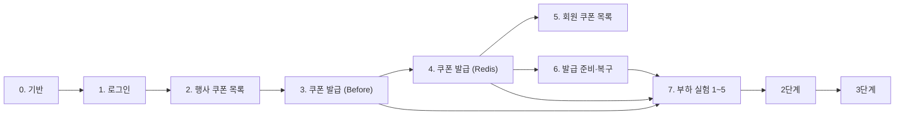

# 구현 순서

설계 문서는 3단계까지 끝났고, 코드는 이 순서대로 작업 하나에 브랜치 하나·PR 하나로 만듭니다.
작업이 끝났는지는 테스트로 판단합니다. 테스트를 어떤 경계에서 하는지는 [개발 규칙의 테스트](conventions.md#테스트)를 따릅니다.

## 쿠폰 발급: 로그인과 한정 수량 쿠폰

| 순서 | 작업 | 문서 | 끝난 기준 |
|---|---|---|---|
| 0 | 기반: docker compose (PostgreSQL, Redis 버전 확정), TypeORM 연결과 마이그레이션 명령, `synchronize` 끄기, `BaseTimeEntity`, int8을 `number`로, `@nestjs-cls/transactional`, 설정 검증, dependency-cruiser 규칙과 `npm run lint` 연결, GitHub Actions(lint, build, test, e2e) | [개발 규칙](conventions.md) | e2e 테스트가 실제 PostgreSQL·Redis에 연결됩니다. `domain/`에서 `typeorm`을 import하면 검사가 실패합니다 |
| 1 | 로그인: member 마이그레이션, 회원 10만 명 시드(같은 비밀번호 해시), JWT 발급, 인증 가드 | [인증](../features/auth/) 시나리오 1~3 | 시나리오의 모든 분기가 e2e로 통과합니다 |
| 2 | 행사 쿠폰 목록: coupon·member_coupon 마이그레이션, 쿠폰 시드(도메인 클래스 경유), 할인 도메인 클래스 | [쿠폰](../features/coupon/) 시나리오 1, [ERD](erd.md) | `FixedDiscount`, `RateDiscount` 경계값 단위 테스트. 목록 e2e |
| 3 | 쿠폰 발급 (Before): `IssuanceStrategy` 포트, 일부러 깨지는 첫 구현, 확인 순서(없음, 중단, 기간, 중복, 소진 순) | [쿠폰 Flow](../features/coupon/flows.md) | 분기별 e2e 통과. 동시성 테스트로 초과 발급이 재현됩니다 (`R1` 재현함) |
| 4 | 쿠폰 발급 (Redis): `RedisFirstIssuance`, 실패 보상(SREM·DECR), UNIQUE 위반 처리 | [ADR-0001](../adr/0001-redis-decides-coupon-issue.md) | 같은 계약 테스트를 두 구현이 통과합니다. 동시성 테스트: 초과 발급 0, 같은 회원 50건 동시 요청이 201 1건 + 409 49건 (`R2`) |
| 5 | 회원 쿠폰 목록: 사용 가능·사용함·만료 계산, 커서 페이지 | 쿠폰 시나리오 3 | e2e |
| 6 | 발급 준비·복구: 발급 시작 전 Redis 채우기, DB 기준 복구 명령 | 쿠폰 시나리오 4 | Redis를 비운 뒤 복구하면 Redis 수 = 회원 쿠폰 수 |
| 7 | 부하 실험 1~5: k6 스크립트(토큰 미리 받기), 기준선, `R1`·`R3`·`R4`·`R5` 측정과 기록 | [실험 계획](../experiments/) | 실험 문서와 README 결과 표에 Before, After 수치 기록 |

## 주문: 상품, 장바구니, 주문, 포인트

| 순서 | 작업 | 문서 |
|---|---|---|
| 8 | 상품·브랜드·재고 마이그레이션과 시드, 상품 조회 | [상품](../features/product/) |
| 9 | 장바구니 | [장바구니](../features/cart/) |
| 10 | 포인트 잔액·내역, `PointPolicy` | [포인트](../features/point/) |
| 11 | 주문서와 금액 계산 (도메인 클래스, 문서의 계산 예시를 테스트로 고정) | [주문](../features/order/) 시나리오 1, 2 |
| 12 | 주문하기와 멱등성 (Before 구현 포함) | 주문 시나리오 3, 4 |
| 13 | 주문 조회, 취소, 구매 확정, 자동 구매 확정 배치 | 주문 시나리오 5~8, 포인트 시나리오 4, 5 |
| 14 | 부하 실험 6~10 (`R6`~`R11`) | [실험 계획](../experiments/) |

## 결제: Mock 결제와 포인트 비동기 적립

3단계 설계는 초안입니다. 2단계를 마친 뒤 [결제 기능](../features/payment/)을 다시 검토하고 ERD에 반영한 다음 시작합니다.

| 순서 | 작업 | 문서 |
|---|---|---|
| 15 | `outbox_event`, 릴레이, 큐 선택(구현 시 확정) | [포인트 Flow](../features/point/flows.md) |
| 16 | 포인트 비동기 적립 | 포인트 시나리오 5 |
| 17 | Mock PG와 결제 상태 | [결제](../features/payment/) |
| 18 | 결제 시간 초과, 결과 확인, 보상 배치 | 결제 시나리오 3~6 |
| 19 | 부하·장애 실험 11, 12 (`R12`~`R14`) | [실험 계획](../experiments/) |

## 작업 하나를 할 때

1. 그 기능의 README·Flow·API와 [ERD](erd.md)를 읽고, 시나리오에 없는 동작은 만들지 않습니다.
2. 브랜치를 만듭니다. 이름은 `<type>/<scope>-<설명>` 형식이고, 예를 들면 `feat/coupon-issue-redis`입니다.
3. 테스트부터 쓰고, 한 번에 한 분기씩 실패와 통과를 반복합니다.
4. 코드와 문서가 다르면 같은 PR에서 문서를 먼저 고칩니다.
5. `lint`, `test`, `test:e2e`, `build`를 통과시키고 PR을 엽니다.

---

[이전: 용어집](glossary.md) | [문서 지도](../README.md)
