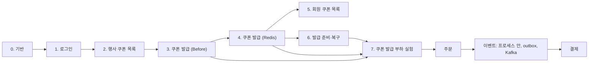

# 구현 순서

설계 문서는 결제까지 끝났고, 코드는 이 순서대로 작업 하나에 브랜치 하나·PR 하나로 만듭니다.
작업이 끝났는지는 테스트로 판단합니다. 테스트를 어떤 경계에서 하는지는 [개발 규칙의 테스트](conventions.md#테스트)를 따릅니다.

## 쿠폰 발급: 로그인과 한정 수량 쿠폰

| 순서 | 작업 | 문서 | 끝난 기준 |
|---|---|---|---|
| 0 | 기반: docker compose (PostgreSQL, Redis 버전 확정), TypeORM 연결과 마이그레이션 명령, `synchronize` 끄기, `BaseTimeEntity`, int8을 `number`로, `@nestjs-cls/transactional`, 설정 검증, dependency-cruiser 규칙과 `npm run lint` 연결, GitHub Actions(lint, build, test, e2e) | [개발 규칙](conventions.md) | e2e 테스트가 실제 PostgreSQL·Redis에 연결됩니다. `domain/`에서 `typeorm`을 import하면 검사가 실패합니다 |
| 1 | 로그인: member 마이그레이션, 회원 10만 명 시드(같은 비밀번호 해시), JWT 발급, 인증 가드 | [인증](../features/auth/)의 로그인, 로그인 실패, 토큰 검사 시나리오 | 시나리오의 모든 분기가 e2e로 통과합니다 |
| 2 | 행사 쿠폰 목록: coupon·member_coupon 마이그레이션, 쿠폰 시드(도메인 클래스 경유), 할인 도메인 클래스 | [쿠폰](../features/coupon/)의 [행사 쿠폰 목록 보기](../features/coupon/README.md#시나리오-1-행사-쿠폰-목록-보기), [ERD](erd.md) | `FixedDiscount`, `RateDiscount` 경계값 단위 테스트. 목록 e2e |
| 3 | 쿠폰 발급 (Before): `IssuanceStrategy` 포트, 일부러 깨지는 첫 구현, 확인 순서(없음, 중단, 기간, 중복, 소진 순) | [쿠폰 Flow](../features/coupon/flows.md) | 분기별 e2e 통과. 동시성 테스트로 초과 발급이 재현됩니다 |
| 4 | 쿠폰 발급 (Redis): `RedisFirstIssuance`, 실패 보상(SREM·DECR), UNIQUE 위반 처리, 결과를 모르는 실패의 재확인 | [Redis가 쿠폰 발급을 결정](../adr/0001-redis-decides-coupon-issue.md) | 세 구현 모두 요청을 한 건씩 보내는 계약 테스트를 통과하고, 동시성 테스트는 Before 구현인 `CountThenInsertIssuance`만 실패하고 나머지 둘은 통과합니다. 동시성 테스트: 초과 발급 0, 같은 회원 50건 동시 요청이 201 1건 + 409 49건 (같은 회원 중복 요청) |
| 5 | 회원 쿠폰 목록: 사용 가능·사용함·만료 계산, 커서 페이지 | 쿠폰의 [회원 쿠폰 목록 보기](../features/coupon/README.md#시나리오-3-회원-쿠폰-목록-보기) | e2e |
| 6 | 발급 준비·복구: 발급 시작 전 Redis 채우기, DB 기준 복구 명령 | 쿠폰의 [발급 준비와 Redis 복구](../features/coupon/README.md#시나리오-4-시스템-발급-준비와-redis-복구) | Redis를 비운 뒤 복구하면 Redis 수 = 회원 쿠폰 수 |
| 7 | 쿠폰 발급 부하 실험(로컬 기준선부터 Lua로 명령 묶기까지): k6 스크립트, 기준선, 초과 발급, 발급 수 불일치, 발급 지연·에러, Redis 재시작 측정과 기록. 이때 정할 것: 토큰을 로그인으로 받을지 미리 서명해 둘지 | [실험 계획](../experiments/) | 실험 문서와 README 결과 표에 Before, After 수치 기록 |

## 주문: 상품, 장바구니, 주문, 포인트

| 순서 | 작업 | 문서 | 끝난 기준 |
|---|---|---|---|
| 8 | 상품·브랜드·재고 마이그레이션과 시드, 상품 조회 | [상품](../features/product/) | 상품 시나리오의 모든 분기가 e2e로 통과합니다. 판매 중지가 품절보다 먼저 보입니다 |
| 9 | 장바구니 | [장바구니](../features/cart/) | 담기 201·수량 늘리기 200·빼기 204가 e2e로 통과합니다. 100종을 넘기면 409입니다 |
| 10 | 포인트 잔액·내역, `PointPolicy`. 테스트용 잔액은 시드로 넣습니다 | [포인트](../features/point/) | `PointPolicy` 경계값 단위 테스트(4,999와 5,000, 10% 한도). 잔액 = 내역 합 |
| 11 | 주문서와 금액 계산 (도메인 클래스, 문서의 계산 예시를 테스트로 고정) | [주문](../features/order/)의 주문서 보기, 쿠폰과 포인트를 골라 금액 미리 보기 | [계산 예시](../features/order/README.md#계산-예시)의 숫자가 단위 테스트로 그대로 나옵니다 |
| 12 | 주문하기와 멱등성 (Before 구현 포함). `EventPublisher`와 핸들러 등록부, 프로세스 안 구현, 장바구니 정리는 주문됨 이벤트로 | 주문의 주문하기, 같은 주문을 두 번 보냄 | 재고 1에 동시 주문 2건이면 201 1건과 409 1건입니다. 같은 키로 동시에 2건이면 주문 1건이고 두 응답이 같은 주문입니다. 장바구니 항목은 `waitForEvents()` 뒤 사라집니다 |
| 13 | 주문 조회, 취소, 구매 확정, 자동 구매 확정 배치. 적립은 구매 확정됨 이벤트를 받는 구독자로 | 주문의 내 주문 목록·상세 보기, 주문 취소, 구매 확정, 자동 구매 확정 / 포인트의 주문 취소로 포인트 돌려받기, 구매 확정으로 포인트 적립 | 취소하면 재고·회원 쿠폰·포인트가 되돌아갑니다. 확정 두 번이면 적립 내역 1건입니다. 배치가 CLS 안에서 트랜잭션으로 돕니다 |
| 14 | 주문·포인트 부하 실험(재고 초과 판매부터 포인트 동시 사용까지) | [실험 계획](../experiments/) | 실험 문서와 README 결과 표에 Before, After 수치 기록 |

## 이벤트: 프로세스 안에서 outbox, Kafka로

적립 이벤트의 전달 방식을 바꿔 가며 한계를 직접 만나고, 다음 방식으로 넘어갑니다. 발행 코드와 구독자 코드는 바꾸지 않고 `EVENT_TRANSPORT`만 바꿉니다 ([모듈 사이 반응은 이벤트로](../adr/0003-module-reactions-through-events.md)).

| 순서 | 작업 | 만날 한계 | 끝난 기준 |
|---|---|---|---|
| 15 | 발행 시점: 트랜잭션 안에서 바로 발행(Before)과 커밋 뒤 발행 비교 | 구독자가 롤백된 확정에 반응하거나 확정 트랜잭션에 섞임 | 어느 쪽인지 테스트로 확인하고 실험 문서에 기록합니다 |
| 16 | 적립 이벤트 유실 재현: 커밋 직후 서버 종료 | 확정됐는데 적립이 없는 주문 (포인트 적립 누락) | 누락이 재현되고 Before 수치가 남습니다 |
| 17 | outbox와 폴링 워커: `outbox_event` 마이그레이션, outbox 구현, 워커, `SKIP LOCKED`. 이때 정할 것: 워커 트랜잭션을 행마다 나눌지, 실패 횟수 상한과 기록 컬럼 | 같은 이벤트 두 번 전달, 폴링 지연, 계속 실패하는 이벤트 | 같은 실험에서 누락 0건. 중복 전달 테스트에서 주문당 적립 내역 1건 |
| 18 | Kafka: docker compose에 Kafka 추가, 릴레이, 컨슈머 그룹, 처리하지 못한 메시지 처리. 이때 정할 것: Kafka 버전과 클라이언트, 재시도 토픽과 실패 토픽 | 파티션 안에서만 지켜지는 순서, 컨슈머가 바뀔 때의 중복, 밀린 메시지 | `EVENT_TRANSPORT=kafka`로 같은 테스트가 코드 변경 없이 통과합니다 |
| 19 | 이벤트 실험(이벤트 발행 시점부터 Kafka로 전달까지) | | 실험 문서와 README 결과 표에 Before, After 수치 기록 |

## 결제: Mock 결제

결제 설계는 초안입니다. 이벤트를 마친 뒤 [결제 기능](../features/payment/)을 다시 검토하고 ERD에 반영한 다음 시작합니다.

| 순서 | 작업 | 문서 |
|---|---|---|
| 20 | Mock PG와 결제 상태 | [결제](../features/payment/) |
| 21 | 결제 시간 초과, 결과 확인, 보상 배치. 승인 취소 재시도는 `outbox_event` 작업으로 | 결제의 주문 후 20분 안에 결제하지 않음, 승인 요청의 응답을 받지 못함, 승인은 됐는데 주문 처리가 실패, 결제된 주문 취소 |
| 22 | 결제 장애 주입 실험 | [실험 계획](../experiments/) |

실험의 Before 구현을 어떻게 끼울지(포트로 바꿔 끼울지, 제약을 뺀 실험용 마이그레이션을 쓸지)는 그 실험을 하는 작업에서 정합니다.

## 작업 하나를 할 때

1. 그 기능의 README·Flow·API와 [ERD](erd.md)를 읽고, 시나리오에 없는 동작은 만들지 않습니다.
2. 브랜치를 만듭니다. 이름은 `<type>/<scope>-<설명>` 형식이고, 예를 들면 `feat/coupon-issue-redis`입니다.
3. 테스트부터 쓰고, 한 번에 한 분기씩 실패와 통과를 반복합니다.
4. 코드와 문서가 다르면 같은 PR에서 문서를 먼저 고칩니다.
5. `lint`, `test`, `test:e2e`, `build`를 통과시키고 PR을 엽니다.

---

[이전: 용어집](glossary.md) | [문서 지도](../README.md)
