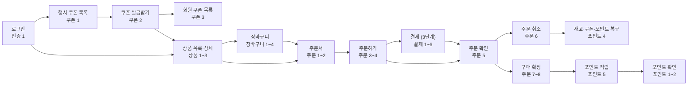
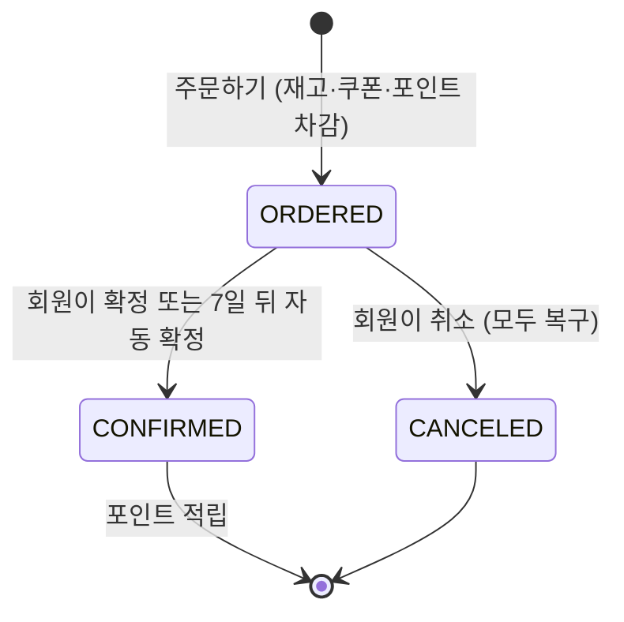

# 유저 플로우

회원이 행사에 들어와서 포인트를 받기까지 일어날 수 있는 모든 흐름의 지도입니다.
흐름마다 자세한 시나리오는 기능 문서에 있고, 여기서는 전체 순서와 번호만 정합니다.
번호는 쿠폰 시나리오 2처럼 `<기능> 시나리오 N`으로 부릅니다.

## 전체 여정

## 상태로 본 주문의 일생

3단계에서 결제가 들어오면 `ORDERED` 앞에 결제 상태가 생깁니다 ([결제 기능](../features/payment/)).

## 모든 흐름

### 인증 ([문서](../features/auth/))

| 번호 | 흐름 | 결과 | 단계 |
|---|---|---|---|
| 1 | 이메일과 비밀번호로 로그인 | 토큰 생성 | 1 |
| 2 | 로그인 실패: 이메일 없음, 비밀번호 틀림, 탈퇴 회원 | 모두 같은 401. 어느 쪽이 틀렸는지 알려주지 않음 | 1 |
| 3 | 토큰 없이, 잘못된 토큰, 만료된 토큰으로 요청 | 401 | 1 |

### 상품 ([문서](../features/product/))

| 번호 | 흐름 | 결과 | 단계 |
|---|---|---|---|
| 1 | 브랜드 목록 보기 | 브랜드 목록 | 2 |
| 2 | 상품 목록 보기 (브랜드로 거르기) | 판매 중·품절·판매 중지가 표시된 목록. 삭제된 상품은 없음 | 2 |
| 3 | 상품 상세 보기 | 판매 중·품절·판매 중지 표시. 삭제된 상품은 404 | 2 |

### 쿠폰 ([문서](../features/coupon/))

| 번호 | 흐름 | 결과 | 단계 | Risk |
|---|---|---|---|---|
| 1 | 행사 쿠폰 목록 보기 | 받을 수 있거나 곧 열릴 쿠폰 목록 | 1 | |
| 2 | 쿠폰 발급받기 | 성공 / 소진 / 이미 받음 / 시작 전 / 종료 / 발급 중단 / 없음 / 다시 시도 | 1 | R1~R4 |
| 3 | 회원 쿠폰 목록 보기 | 사용 가능·사용함·만료로 나눈 목록 | 1 | |
| 4 | (시스템) 발급 준비와 Redis 복구 | 발급 시작 전과 Redis 재시작 뒤 DB 기준으로 Redis를 채움 | 1 | R3, R5 |

### 장바구니 ([문서](../features/cart/))

| 번호 | 흐름 | 결과 | 단계 |
|---|---|---|---|
| 1 | 장바구니에 담기 | 처음이면 장바구니 생성. 이미 담긴 상품이면 수량 증가. 판매 중지·삭제 상품은 거절. 품절 상품은 담을 수 있음 | 2 |
| 2 | 장바구니 보기 | 지금 가격과 판매 상태 (판매 중·품절·판매 중지) | 2 |
| 3 | 수량 바꾸기 | 1~99개 | 2 |
| 4 | 빼기 | 하나 또는 여러 개를 실제로 지움 | 2 |

### 주문 ([문서](../features/order/))

| 번호 | 흐름 | 결과 | 단계 | Risk |
|---|---|---|---|---|
| 1 | 주문서 보기 (장바구니에서 고르기 또는 바로 구매) | 상품 금액, 상품별·주문별로 쓸 수 있는 쿠폰, 쓸 수 있는 포인트 한도 | 2 | |
| 2 | 쿠폰과 포인트를 골라 금액 미리 보기 | 할인·포인트·결제 금액 계산. 저장하지 않음 | 2 | R9 |
| 3 | 주문하기 | 성공 / 품절 / 판매 중지·삭제 / 쿠폰 사용 불가 / 포인트 사용 불가 / 금액 바뀜 | 2 | R6~R9, R11 |
| 4 | 같은 주문을 두 번 보냄 | 주문은 하나. 두 번째는 첫 주문을 그대로 응답 | 2 | R10 |
| 5 | 내 주문 목록·상세 보기 | 주문 시점 이름·가격·할인 | 2 | |
| 6 | 주문 취소 | 재고·쿠폰·포인트 복구. 이미 취소·확정된 주문은 409 | 2 | |
| 7 | 구매 확정 | 포인트 적립. 확정 뒤에는 취소 불가 | 2 | |
| 8 | (시스템) 자동 구매 확정 | 주문 7일 뒤 확정되지 않은 주문을 확정 | 2 | |

### 포인트 ([문서](../features/point/))

| 번호 | 흐름 | 결과 | 단계 | Risk |
|---|---|---|---|---|
| 1 | 포인트 잔액 보기 | 잔액 | 2 | |
| 2 | 포인트 내역 보기 | 적립·사용·사용 취소 내역 | 2 | |
| 3 | 주문에 포인트 쓰기 | 5천 원 이상, 쿠폰 할인 뒤 금액의 10%까지. 잔액이 모자라면 409 | 2 | R11 |
| 4 | 주문 취소로 포인트 돌려받기 | 쓴 포인트만큼 다시 쌓임 | 2 | |
| 5 | 구매 확정으로 포인트 적립 | 결제 금액의 5%. 2단계는 확정과 같은 트랜잭션, 3단계는 비동기 | 2, 3 | R12 |

### 결제 ([문서](../features/payment/), 3단계 초안)

| 번호 | 흐름 | 결과 | 단계 | Risk |
|---|---|---|---|---|
| 1 | 주문 후 결제 승인 | 결제 완료. 주문 상태가 `ORDERED`가 됨 | 3 | |
| 2 | 결제 거절 | 결제 실패. 재고·쿠폰·포인트 복구 | 3 | |
| 3 | 주문 후 20분 안에 결제하지 않음 | 자동 결제 실패. 복구 | 3 | |
| 4 | 승인 요청의 응답을 받지 못함 | 결제사에 결과를 조회해서 확정 | 3 | R14 |
| 5 | 승인은 됐는데 주문 처리가 실패 | 다시 시도해서 주문을 끝냅니다. 끝낼 수 없을 때만 승인을 취소하고, 그것도 실패하면 다시 시도할 목록에 올립니다 | 3 | R13 |
| 6 | 결제된 주문 취소 | 결제 취소 후 주문 취소 | 3 | R13 |

### 관리자 (범위 밖, 규칙만)

관리자 기능은 만들지 않고 데이터는 시드로 넣습니다. 나중에 만들 때 지킬 규칙만 적어 둡니다.

| 행동 | 규칙 |
|---|---|
| 쿠폰 생성 | 할인 규칙은 도메인 클래스가 검사합니다. 상품 쿠폰은 대상이 하나 이상 있어야 합니다 |
| 발급 중단 | `coupon.status = STOPPED`. 이미 받은 회원 쿠폰은 그대로 쓸 수 있습니다 |
| 회수 | 회원 쿠폰을 쓸 수 없게 합니다. `REVOKED` 상태는 그때 추가합니다 |
| 쿠폰 삭제 | 발급 시작 10분 전까지만 합니다 |
| 조건 변경 | 발급이 시작된 쿠폰의 한정 수량과 할인 조건은 바꿀 수 없습니다 |
| 판매 중지 | `product.status = STOPPED`. 장바구니에는 남지만 주문할 수 없습니다 |
| 상품 삭제 | 판매 중지된 상품만 삭제하고, 그 상품의 장바구니 항목도 같이 지웁니다 |

## 흐름 사이에 걸린 규칙

여러 기능에 걸쳐 있어서 한 기능 문서에만 둘 수 없는 규칙입니다.

| 규칙 | 관련 흐름 |
|---|---|
| 쿠폰·재고·포인트는 주문 트랜잭션 하나에서 함께 차감하고, 취소 트랜잭션 하나에서 함께 복구합니다 | 주문 3, 6 / 포인트 3, 4 |
| 데드락을 막으려고 여러 상품의 재고는 상품 ID 순서로 차감합니다 | 주문 3 |
| 취소와 구매 확정이 동시에 오면 먼저 커밋된 쪽만 성공합니다 (`WHERE status = 'ORDERED'`) | 주문 6, 7, 8 |
| 할인은 상품 쿠폰, 주문 쿠폰, 포인트 순서로 계산합니다 | 주문 1~3 |
| 품절은 장바구니에 담을 때가 아니라 주문할 때 확인합니다 | 장바구니 1 / 주문 3 |
| 쿠폰의 만료와 상품의 품절은 저장하지 않고 계산합니다 | 쿠폰 3 / 상품 2, 3 |

---

[이전: 문제 정의](problem.md) | [문서 지도](../README.md) | [다음: ERD](erd.md)
